# Agisoft Texture De-Lighter 2.2.2 逆向工程算法架构与 UI 控制流分析报告

> **分析对象**：`/Applications/Delighter.app/Contents/MacOS/Delighter`（Agisoft Texture De-Lighter `2.2.2`，macOS Universal Mach-O 二进制）  
> **基准切片**：`arm64` 架构切片（Fat 文件偏移 `0x3e18000` / `65,110,016` 字节，切片大小 `55,255,120` 字节）  
> **合规声明**：本报告严格限定于计算机图形学、纹理图像处理、去阴影/去光照（De-lighting）算法架构、Qt5 UI 参数映射与顶层控制流分析；不涉及任何许可证、硬件锁、崩溃上报或网络传输模块，亦不包含逐行还原的商业闭源源码。

---

## 一、二进制总体结构与核心发现总览

### 1.1 Mach-O (`arm64`) 段布局与符号恢复来源

虽然 `Delighter` 主程序移除了常规局部符号表，但由于静态链接了大量 Agisoft Metashape 公共图形库、启用了 **Clang OpenMP (`libomp.dylib`)**、保留了完整的 **C++ RTTI (`__ZTS*` / `__ZTI*` / `__ZTV*`)** 以及 **Qt 5.15.14 元对象表 (`QMetaObject`)**，其算法模块边界、源码文件名、行号与调用链均可被 100% 精确重建：

| Mach-O 段 / 节 (`arm64`) | 虚拟地址范围 (VA) | 切片内偏移 | 大小 | 逆向工程关键信息载体 |
|---|---|---|---|---|
| `__TEXT,__text` | `0x100006544 .. 0x10247dbf4` | `0x00006544` | `38.24 MB` (`0x24776b0`) | `LC_FUNCTION_STARTS` 共解码 **88,348 个函数**；去光照核心算子集中在 `0x100342b9c .. 0x100495200`，任务编排集中在 `0x1009a64ac .. 0x1009b0100` |
| `__TEXT,__const` | `0x102625670 .. 0x102b9fb40` | `0x02625670` | `5.48 MB` (`0x57a4d0`) | Qt 元对象整数表 (`qt_meta_data_*`)、浮点常量表、跳转表。`0.36` / `1/2.2` 不在此池，而在 `mov`/`movk`（见 `02` §1.1） |
| `__TEXT,__cstring` | `0x102b9fb40 .. 0x102d27b8b` | `0x02b9fb40` | `1.53 MB` (`0x18804b`) | **53,117 条 C 字符串**，含 **1,406 条 OpenMP `ident_t` 源码定位串**（格式 `;filepath;func;line;col;;`）、调试贴图文件名（如 `scale_strip.png`）与计时日志 |
| `__DATA_CONST,__const` | `0x102d99510 .. 0x102e7c9b8` | `0x02d99510` | `909 KB` (`0x0e34a8`) | C++ RTTI `type_info` (`__ZTI*`)、虚函数表 (`__ZTV*`)、322 个 OpenMP `ident_t` 描述符结构体、Qt `staticMetaObject` 实例 |
| `__DATA,__data` | `0x102e83bd0 .. 0x1033df200` | `0x02e83bd0` | `5.36 MB` (`0x55b630`) | Qt 5 `QByteArrayData` 字符串表 (`qt_meta_stringdata_*`) |

### 1.2 核心架构结论（四大颠覆性实证）

1. **并非单一管线，而是并存“双核心交互管线 + 一套传统批处理管线”**：
   - `Delighter.app` 的核心交互面板 `DelighterPane`（窗口标题 `Controls` / `控制`）将去光照拆分为两个**完全独立触发**的按钮组，统一由后台任务 `TaskRemoveLightingInteractive` (`0x1009a897c`) 通过 `params.algorithm` 字段分流：
     - **`algorithm = 0` — `Remove Cast Shadows`（移除投射阴影，`0x100373330`）**：交互式笔刷驱动（必须涂抹 `Shadow` 与 `Lit` 样本，可选涂抹同质材质 `Shadow Scale Map`），采用 **PatchMatch KNN 抠图 -> 双轮引导滤波 -> 本影/半影/受光三分图 -> 半影修复 -> 阴影边界比例条带 (`Scale Strip`) 提取 -> 多尺度弹簧系统比例扩散 (`Inpainting Scale`) -> 高光与异色伪影抑制** 的 11 步流水线。
     - **`algorithm = 1` — `Remove Shading`（移除漫反射明暗与环境光遮蔽，`0x1003644c8`）**：全自动三维几何驱动（无需笔刷），基于 3D 网格光栅化出 UV 空间 `PositionMap`、`NormalMap`（经彩色纹理引导滤波去刻面噪声）和光线追踪烘焙的 `AO` 贴图，建立 **3D 空间八叉树金字塔 $\times$ $32\times 16$ 经纬度法线方向均值容器 (`LLAvgContainer`)**，根据局部 AO 遮蔽深度自适应选择空间层级估算方向性环境光比例 `scale_full`。
   - 此外，二进制还完整编译了继承自 Metashape 的传统单向自动去光照管线：`RemoveLightingDialog` (`0x10008490c`) -> `CommandRemoveLighting` -> `TaskRemoveLighting` (`0x1009a64ac`) -> `0x100342b9c`，这正是 RTTI 中四个策略类 `DPPSSingle_Delight`、`DPPSMulti_Delight`、`DPPSSingle_GetHighlightsCorrection`、`DPPSMulti_GetHighlightsCorrection` 的真实宿主。
2. **色彩空间不是对数域 Retinex。HDR 进出桥已由指令级复原改写（见 `02_core_algorithms_math_rea.md` §1.1），本节旧表述作废**：
   - 旧稿把 `0x4031c71c` 当成伽马指数 \(1/0.36\)。该位型只出现在 `mov`/`movk` 里，是**乘数** \(1/0.36\)，不是幂。数据类型码 5/8/11 的 worker（`0x1009ae4b0` → `0x1009ae54c`）顺序是：先乘 \(1/0.36\)，float16 往返，再做 \(^{1/2.2}\)（`0x3ee8ba2e`）。还原是 \(0.36\cdot I^{2.2}\)（`0x1009af12c`，幂 `0x400ccccd`）。整型纹理不走这条桥。反照率仍是 \(A=\mathrm{clamp}(I\oslash S,0,1)\)。
3. **`libpoisson6` 与 2D 泊松图像编辑毫无关系；全局稀疏求解的真相是“$\le 1024$ CHOLMOD 直接分解 + $> 1024$ 多重网格金字塔 Eigen 稀疏共轭梯度法 (`SpringsSolverCG`)”**：
   - `3rdparty/libpoisson6`（Kazhdan & Bolitho 2006）仅封装在 `PoissonSolver` (`0x1004c5008`) 中用于三维点云八叉树表面重建（日志 `'Grid size: X x Y x Z'`），去光照模块对其**零调用**。
   - 真正承担跨 UV 接缝平滑插值与修复的是 `atlas_inpainting.cpp` (`0x10043f0f0` -> `0x10043fa0c`) 构建的**各向同性/跨接缝弹簧网络（Spring System, 求解正规方程 $A^T A \mathbf{x} = A^T \mathbf{b}$）**：当纹理长边 $\max(W, H) \le 1024$ (`#0x400`) 时，直接调用 `inpaintCholesky` (`0x10044083c`) 经 `geom::CholmodSolver`（SuiteSparse CHOLMOD 7.8.0）做稀疏 Cholesky 直接求解；当 $\max(W, H) > 1024$ 时，递归 $2\times$ 下采样至 $\le 1024$ 用 CHOLMOD 求粗网格初值 `inpaint_x0_`，再逐层上采样并在高分辨率层改用 OpenMP 并行的 **`Eigen::SparseMatrix<float>` 共轭梯度求解器 `inpaintCG` (`SpringsSolverCG`, `0x100441d08`)** 迭代收敛。
4. **跨 UV 孤岛连续性的核心基础设施是 `TeleportMap`（UV 接缝传送表）**：
   - `teleport_map.cpp` 中的 `atlas_processing::makeTeleportMap` (`0x1003feeac`) 利用 3D 网格拓扑边连接关系，在 UV 孤岛（Charts）边界外侧建立像素级的“虫洞传送坐标映射”。后续所有的盒式高斯模糊 (`atlas_gauss_blur.cpp`)、最大值膨胀 (`atlas_max_filter.cpp`)、PatchMatch 传播 (`atlas_matting.cpp`)、半影膨胀 (`dilatePenumbraFast`) 以及弹簧矩阵构建 (`atlas_inpainting.cpp`) 均在遇到 UV 边界时通过 `TeleportMap` 直接采样三维空间相邻的另一块 UV 孤岛像素，从根本上消除了三维模型 UV 接缝处的去阴影断裂伪影。

---

## 二、旧版猜测报告纠偏对照表

对比工作区旧版推测文档 `/Users/chichenchichen/Desktop/cursor/de_lighter/Agisoft De-Lighter 原理分析.md`（基于许可证文件名做的黑盒猜测），本次二进制级逆向实证纠偏如下：

| 维度 | 旧版报告的黑盒猜测 | `Delighter` 2.2.2 二进制逆向实证真相 | 关键指令 / 符号地址证据 |
|---|---|---|---|
| **`poisson` 库用途** | 误判为 **2D 泊松图像编辑（Poisson Image Editing）**，认为在梯度域求解 $\nabla^2 s^* = \text{div}(\mathbf{v})$ 重建无影图像 | **完全错误**。`poisson` 实为 Kazhdan 2006 **3D 屏蔽泊松点云八叉树表面重建 (`libpoisson6`)**，仅被 Metashape 公共库中的 `TaskBuildModel` 调用，去光照管线对其**零引用** | `PoissonSolver` (`0x1004c5008`), `3rdparty/libpoisson6/MultiGridOctreeData.inl` (`0x1013d0690`) |
| **`openmesh` 库存在性** | 猜测依赖 `OpenMesh` 半边数据结构计算顶点曲率、法线与折痕角 | **完全不存在**。2.2.2 版 `Resources/licenses` 及二进制中均无 `OpenMesh`；网格结构采用 Agisoft 自研 `Mesh` (`source/model/mesh/mesh.cpp`) 与 `geom::BaseTriMesh` | `Mesh` (`0x100d90000+`), `UVMeshRenderer` (`0x102da75e8`) |
| **本征分解数学域** | 猜测将 sRGB 按标准 $\gamma=2.2$ 线性化后**取对数 $\log(I) = \log(R) + \log(S)$**，转化为加性线性方程组 | **对数域错误，幂指数也不是 \(1/0.36\)**。HDR 桥是 \((\mathrm{half}(I/0.36))^{1/2.2}\)，回去是 \(0.36\cdot I^{2.2}\)；光照是三通道乘性比例，\(A=\mathrm{clamp}(I\oslash S,0,1)\) | worker `0x1009ae54c`（幂 `1/2.2`）、`0x1009af12c`（幂 `2.2`）；详见 `02` §1.1 |
| **`CHOLMOD` 求解对象与规模** | 猜测对整张千万像素级纹理直接建立全局本征分解（IID）大型稀疏矩阵并用 CHOLMOD 一次性直接因子分解 | **错误**。CHOLMOD 仅在 `atlas_inpainting.cpp` 的 `inpaintCholesky` 中被调用，且**严格限制在金字塔粗层 $\max(W,H) \le 1024$** 求解跨接缝弹簧系统 $A^T A \mathbf{x} = A^T \mathbf{b}$；高于 `1024` 的精细层全部改用 **Eigen 稀疏共轭梯度法 `inpaintCG` (`SpringsSolverCG`)** | 分辨率阈值判断 `cmp x8, #0x400` (`0x10043fbf4`), `inpaintCholesky` (`0x10044083c`), `inpaintCG` (`0x100441d08`) |
| **`guided-filter` 引导方向** | 猜测以 **3D 法线图/AO 图作为引导图（Guide）** 去滤波对数纹理图像，将几何边缘迁移到光照层 | **方向完全相反**。二进制中共有两处调用 Atilim Cetin `guided-filter` (`0x10041838c`)：<br>1. `Remove Shading` 中**以 RGB 彩色纹理为引导图去滤波 3D 法线图** (`0x1003fd8d8`)，消除低模三角面折痕并迁移纹理高频凹凸结构；<br>2. `Remove Cast Shadows` 中**以修复后的 RGB 彩色纹理为引导图（第 1 轮）+ 自引导（第 2 轮）滤波 PatchMatch 粗糙阴影抠图蒙版** (`0x100374d70`, `0x100374e88`) | 法线引导滤波 `0x1003fd8d8..0x1003fda78`；抠图双轮引导滤波 `0x100374d70..0x100374ea0` |
| **`draco` / `alembic` 角色** | 猜测在管线中承担高速几何数据流转或相机/光源先验提取 | **夸大**。二者仅是 15 种模型读写器（`ModelReaderABC`、`ModelReaderDRC` 等）中的两种普通文件 I/O 格式插件，不参与任何去光照计算 | `ModelReader*` / `ModelWriter*` RTTI (`0x102db0dc8..0x102db11b0`) |

### 1.3 第三方库真实职责核查表（基于 `Contents/Resources/licenses` 与代码交叉引用）

在排除安全边界外无关组件后，`Delighter.app` 静态/动态链接的图形与数学第三方库真实职责如下：

- **实际直接参与去光照核心计算的第三方库（4 个）**：
  1. **`cholmod` (SuiteSparse 7.8.0)** + **`openblas`**：封装于 `geom::CholmodSolver::CholmodSolverImpl` (`0x101b29c60` factorize / `0x101b29e0c` solve)，供 `atlas_inpainting` 粗尺度（$\le 1024$）直接求解跨接缝弹簧线性系统。
  2. **`Eigen`（头文件模板库）**：提供 OpenMP 并行的 `Eigen::internal::general_matrix_vector_product<..., float, RowMajor>` (`0x100446ee0`)，供 `atlas_inpainting` 细尺度（$> 1024$）共轭梯度求解器 `SpringsSolverCG` 使用。
  3. **`guided-filter` (Atilim Cetin, 2014)**：封装于 `0x10041838c`，用于 `Remove Shading` 法线图精细化与 `Remove Cast Shadows` 阴影 Alpha 蒙版边缘保持平滑。
  4. **`opencv`**：在 `scale_strip.cpp` (`0x1003fa618` `getImageEdges`) 中用于阴影边界 Canny 边缘检测（调参串 `"canny_low_thr"`、`canny.png`）及基础图像结构辅助。
- **仅用于模型/纹理文件 I/O、UI 渲染或未激活 Metashape 公共死代码的库**：
  - **UI 与三维视口**：`qt` (Qt 5.15.14，`libqcocoa.dylib`)、`glew`（OpenGL 视口着色器与笔刷绘制）。
  - **三维模型 I/O 格式**：`alembic` (`.abc`)、`draco` (`.drc`)、`smallfbx` (`.fbx`)、`openscenegraph` (`.osgb`/`.ive`)、`u3d` (`.u3d`)，外加自研 OBJ/PLY/GLTF/DAE/3DS/STL/DXF/CTM。
  - **纹理解码与编码**：`libtiff`、`openexr` + `ilmbase`（`16f`/`32f` HDR 纹理）、`libwebp`、`openjpeg`、`libsquish` (DXT 压缩)。
  - **链接但未被去光照管线调用的公共库**：`poisson` (`libpoisson6`)、`uvatlas`、`xatlas`、`meshoptimizer`、`laszip`、`geographiclib`、`gpmf-parser`、`zxing`。

---

## 三、Qt `.qm` 语言包与 `QMetaObject` 元对象全量解析

### 3.1 语言包结构概览
- `/Applications/Delighter.app/Contents/MacOS/lang/delighter_en.qm`（`1,092` 字节）：仅包含 **15 条**物理单位符号美化规则（如 `(deg)` $\to$ `(°)`、`um` $\to$ `μm`、`pix` $\to$ `px`），英文界面直接回退使用源码内嵌字面量。
- `/Applications/Delighter.app/Contents/MacOS/lang/delighter_zh_CN.qm`（`448,565` 字节）：共包含 **5,980 条**中英文词条（复用 Agisoft Metashape 统一翻译库）。

### 3.2 `DelighterPane`（交互式控制面板）中英文词条全集

| 英文原文 (`Source Text`) | 简体中文翻译 (`delighter_zh_CN.qm`) | 界面位置 / 控件角色说明 |
|---|---|---|
| `Controls` | `控制` | 右侧主停靠面板 `DelighterPane` 标题 |
| `Show or hide Controls pane` | `显示或隐藏控制台窗口` | 视图菜单切换提示 |
| **`Remove Cast Shadows`** | **`移除投射阴影`** | **第一功能分组框标题 / 正式执行按钮文本** |
| `Highlights suppression:` | `高光抑制：` | 投射阴影组下拉框标签 (`[pane + 0x40]`) |
| `Suppresses too bright areas on processed texture` | `抑制处理过纹理上的过亮区域` | `Highlights suppression` 悬停提示 (Tooltip) |
| `Color artifacts suppression:` | `抑制色彩伪影：` | 投射阴影组下拉框标签 (`[pane + 0x48]`) |
| `Suppresses areas with wrong colors on processed texture` | `抑制处理过纹理上的错误颜色区域` | `Color artifacts suppression` 悬停提示 |
| `None` / `Low` / `Medium` / `High` | `无` / `低` / `中` / `高` | 抑制强度与局部性等级枚举项 |
| `Remove Cast Shadows (Preview)` | `移除投射阴影（预览）` | 预览按钮 (`onPreview()`，纹理长宽降采样至 $1/4$) |
| `Fast process downscaled texture to evaluate specified parameters` | `快速处理降尺度纹理以评估指定参数` | 两个 `(Preview)` 按钮共用的悬停提示 |
| `Process full resolution texture using specified parameters` | `使用指定的参数处理全分辨率纹理` | 两个正式执行按钮共用的悬停提示 |
| **`Remove Shading`** | **`移除阴影`** *(注：意为移除漫反射明暗)* | **第二功能分组框标题 / 正式执行按钮文本** |
| `Locality:` | `地点：` *(注：直译误译，实为空间局部性)* | 明暗去除组下拉框标签 (`[pane + 0x50]`) |
| `Makes resulting texture color more uniform` | `使得产生的纹理颜色更加统一` | `Locality` 悬停提示 |
| `Remove AO:` | `移除AO：` | 环境光遮蔽消除复选框标签 (`[pane + 0x58]`) |
| `Generate and use ambient occlusion map for shading removal` | `生成并使用环境遮蔽图来消除阴影` | `Remove AO` 悬停提示 |
| `AO removal strength:` | `AO消除力度：` | AO 消除强度浮点微调框标签 (`[pane + 0x60]`) |
| `Strength of ambient occlusion removal` | `环境遮蔽图的消除力度` | `AO removal strength` 悬停提示 |
| `Remove Shading (Preview)` | `移除阴影（预览）` | 明暗去除预览按钮 (`onRemoveShadingPreview()`) |
| `Reset Defaults` | `重置默认` | 两个分组各自的恢复默认参数按钮 |
| `Reset settings to default values` | `重置所有设置为默认值` | `Reset Defaults` 悬停提示 |
| `Bake active mask to diffuse` | `烘焙活跃的蒙版以形成漫反射纹理贴图` | 辅助动作 (`onBakeActiveMaskToDiffuse()`) |
| `Shadow threshold:` *(2.2.2 隐藏)* | `阴影阙值：` | `.qm` 保留词条，2.2.2 转为隐藏 `QSettings` 参数 (`bright_threshold`) |
| `Penumbra width:` *(2.2.2 隐藏)* | `半影宽度：` | `.qm` 保留词条，2.2.2 转为隐藏 `QSettings` 参数 (`penumbra_width`) |

### 3.3 笔刷调色板（Palette）、模型菜单与传统批处理对话框词条对照表

| Context | 英文原文 (`Source Text`) | 简体中文翻译 (`zh_CN`) | 内部动作名 / 掩码行为说明 |
|---|---|---|---|
| `MainActions` | `&File` / `&View` / `&Help` | `文件(&F)` / `视图(&V)` / `帮助(&H)` | `Delighter.app` 顶层仅保留此 3 个主菜单 |
| `MainWindow` | `Brush Size` | *(工具栏滑块标签)* | 3D 视口涂抹笔刷半径调整 |
| `MainActions` | `Brush` / `Brush tool` | `笔刷` / `笔刷工具` | `model_brush`，激活 `ModelView::ToolDrawBrush` |
| `MainActions` | `Shadow Color` / `Shadow brush color` | `阴影颜色` / `阴影笔刷颜色` | `model_brush_color_shadow`，在 `delighting/shadow` 掩码写入 **`0x80` (`128`)** |
| `MainActions` | `Lit Color` / `Lit brush color` | `高亮` *(注：指受光区)* | `model_brush_color_lit`，在 `delighting/shadow` 掩码写入 **`0xff` (`255`)** |
| `MainActions` | `Extra Color` / `Extra brush color` | `补充` | `model_brush_color_extra`，在激活的 `Shadow Scale Map` (`delighting/material`) 写入 **`0xff`** |
| `MainActions` | `Erase` / `Brush eraser` | `擦除` / `笔刷橡皮擦` | `model_brush_eraser`，将对应掩码擦除为 **`0x00` (`0`)** |
| `MainActions` | `Hide brush` / `Hide brush strokes` | `隐藏笔刷` / `隐藏笔刷笔触` | `model_brush_hider`，切换视口笔刷遮罩叠加层显隐 |
| `MainActions` | `Clear Shadow` / `Clear Lit` / `Clear Extra` | `清除阴影` / `清除高亮` / `清除补充` | 批量清空对应类别的所有笔刷样本像素 |
| `MainActions` | `Delight` / `Delight model` | `去光照` / `去光照模式` | `model_delight`，切换视口交互去光照工作模式 |
| `ModelActions` | `Add Shadow Scale Map` | `添加阴影比例图` | `onAddMaterialMap()`，为模型新增一层同质材质比例掩码 (`TextureType=4`) |
| `ModelActions` | `Remove Lighting...` | `移除光照...` | `onRemoveLighting()`，弹出传统批处理对话框 `RemoveLightingDialog` |
| `ModelActions` | `Remove Lighting Interactive...` | `移除照明交互...` | `onRemoveLightingInteractive()`，聚焦交互式 `DelighterPane` |
| `RemoveLightingDialog` | `Remove Lighting` | `移除光照` | 传统自动去光照对话框标题 |
| `RemoveLightingDialog` | `Color mode:` (`Single color` / `Multi color`) | `颜色模式：` (`单色` / `多色`) | 控制选用 `DPPSSingle_*` (`0`) 还是 `DPPSMulti_*` (`1`) 策略类 |
| `RemoveLightingDialog` | `Presets:` (`Default` / `Aggressive (for rocks)`) | `预设：` (`默认` / `激进（针对岩石）`) | 选择 `Aggressive` 时自动将 `Internal blur` 设为 `0.0` (`None`) |
| `RemoveLightingDialog` | `Ambient occlusion map (optional):` | `环境遮蔽图（可选）：` | 支持导入外部预烘焙的 AO 模型纹理 |
| `RemoveLightingDialog` | `Internal blur:` (`None`/`Low`/`Medium`/`High`) | `内部模糊：` (`无`/`低`/`中`/`高`) | 映射浮点半径：`0.0` / `1.5` (默认) / `2.5` / `4.0` |
| `RemoveLightingDialog` | `Ambient occlusion multiplier:` | `环境遮蔽倍数：` | `QDoubleSpinBox`，范围 `[0.25, 4.00]`，默认 `1.50` |
| `RemoveLightingDialog` | `Model noise suppression:` | `模型噪声抑制：` | `QDoubleSpinBox`，范围 `[0.00, 4.00]`，默认 `1.00` |

### 3.4 进度提示、控制台计时日志与异常报错文本清单

从 `.qm` (`Operations` 上下文) 与二进制 `__TEXT,__cstring` 中提取的全部运行时阶段提示与校验报错如下：

- **通用与预处理阶段**：
  - `"Removing lighting..."`（`正在移除光照...`）
  - `"Preprocessing textures..."` / `"Postprocessing textures..."`（`TaskRemoveLighting`）
  - `"Calculating ambient occlusion..."` / `"Baking ambient occlusion map..."`（AO 光线追踪烘焙，`baking/prep.cpp`）
  - `"Processed "` / `"Processed (preview) "`（生成的去光照新模型命名前缀）
- **`Remove Shading` 专属阶段日志（`0x10034d1ec .. 0x10034dcc4`）**：
  - `"Calculating angular data..."` $\to$ `"Calculating scale..."` $\to$ `"Suppressing highlights..."` $\to$ `"Applying scale..."`
  - 计时细项：`"exclusion_mask in "`、`"ll_avg in "`、`"scale_full in "`、`"scale_full_suppressed in "`、`"delit in "`
- **`Remove Cast Shadows` 专属阶段日志（`0x100374704 .. 0x1003775c0`）**：
  - `"Repairing atlas..."` $\to$ `"Baking matting..."` $\to$ `"Baking shadow masks..."` $\to$ `"Inpainting penumbra..."` $\to$ `"Obtaining scale strip..."` $\to$ `"Inpainting scale..."` $\to$ `"Obtaining scale from materials..."` $\to$ `"Suppressing highlights..."` $\to$ `"Suppressing unknown colors..."` $\to$ `"Applying scale..."`
  - 求解器与引导滤波细项：`"Building springs..."`、`"AtA nnz: "`、`"Solving direct ("`、`"Solving recursive ("`、`"Solving ("`、`"  gf convert : "`、`"  gf self: "`、`"  gf gb: "`、`"gf finished in "`、`"Scale strip finished in "`、`"Hard edges healing finished in "`
- **输入合法性校验异常文本（`0x1009ac000+` & `0x100375600+`）**：
  - 模型/纹理缺失：`"Can't import model without texture"`、`"Null chunk"`、`"Null model"`、`"Empty mesh"` (`faces == 0`)、`"Empty UV mesh"` (`uv_vertices == 0`)、`"Null texture"`、`"Empty diffuse texture"`、`"Small texture size: "`（短边 `< 256` 像素）
  - 笔刷/遮罩缺失：`"Mask empty"`（未绘制阴影/受光笔刷）、`"Shadow samples empty"`（缺少 `0x80` 阴影涂抹）、`"Lit samples empty"`（缺少 `0xff` 受光涂抹）、`"Shadow mask empty"` / `"Light mask empty"` / `"Penumbra mask empty"`、`"Masks intersect"`、`"Invalid mask size"`、`"Unsupported mask channels count"`

### 3.5 核心 Qt `QMetaObject` 元对象与槽函数路由表

在 `__DATA_CONST,__const` 中共扫描出 **53 个业务 `QMetaObject`**（已剔除安全边界外类），其中与去光照 GUI 控制流直接相关的核心元对象及槽函数跳板如下：

| 类名 (`QMetaObject` 地址) | 父类 | `qt_static_metacall` | 信号 (Signals) / 槽函数 (Slots) 完整签名及实现地址 (`arm64`) |
|---|---|---|---|
| **`DelighterPane`**<br>(`0x102d9dd88`) | `QDockWidget` | `0x1000b1030` | `[Slot 0]` `onSaveMaterial()` $\to$ `0x100044480`<br>`[Slot 1]` `onProcess()` $\to$ `0x100042fd8` *(正式移除投射阴影)*<br>`[Slot 2]` `onPreview()` $\to$ `0x100042e48` *(预览移除投射阴影)*<br>`[Slot 3]` `onRemoveShading()` $\to$ `0x10004341c` *(正式移除明暗)*<br>`[Slot 4]` `onRemoveShadingPreview()` $\to$ `0x100043284` *(预览移除明暗)*<br>`[Slot 5]` `onResetDefault()` $\to$ `0x100042d30` *(重置投射阴影默认参数)*<br>`[Slot 6]` `onResetDefaultShading()` $\to$ `0x100043190` *(重置明暗默认参数)*<br>`[Slot 7]` `onBakeActiveMaskToDiffuse()` $\to$ `0x100044880`<br>`[Slot 8]` `onUseAOToggled()` $\to$ `0x100043164` *(联动启用/禁用 AO 强度框)* |
| **`ModelView`**<br>(`0x102d9e378`) | `ModelWidgetGL` | `0x1000b17ac` | 含 69 个信号/槽，去光照交互核心槽：<br>- `onToolDrawBrushSizeChanged(int)` (`0x100051c8c`)<br>- `onToolDrawBrush()` (`0x10004ef00`) / `onToolDrawBrushEraser()` (`0x10004ef9c`) / `onToolDrawBrushHider()` (`0x10004f02c`)<br>- `onToolDrawBrushColorShadow()` (`0x10004f0bc`) / `onToolDrawBrushColorLit()` (`0x10004f14c`) / `onToolDrawBrushColorExtra()` (`0x10004f270`)<br>- `onToolDrawBrushClearShadow()` (`0x10005d23c` $\to$ `0x1006f4288`)<br>- `onToolDrawBrushClearLit()` (`0x10005d3d4` $\to$ `0x1006f4660`)<br>- `onToolDrawBrushClearExtra()` (`0x10005d56c` $\to$ `0x10075b350` / `0x1006f4918`)<br>- `onModelDelight()` (`0x10005dd0c`) |
| **`ModelActions`**<br>(`0x102d9d5a0`) | `AbstractActions` | `0x1000b0984` | `onAddMaterialMap()`, `onRemoveModel()`, `onRenameModel()`, `onExportModel()`, `onChangeColor()`, `onDuplicate()`, `onSetDefault()`, `onRemoveLighting()`, `onRemoveLightingInteractive()`, `onShowInfo()` |
| **`TextureActions`**<br>(`0x102d9d668`) | `AbstractActions` | `0x1000b0b50` | `onRemoveTexture()`, `onSetDefault()` *(管理模型下的 `Diffuse` 与 `Shadow Scale Map` 图层)* |
| **`RemoveLightingDialog`**<br>(`0x102d9fbc8`) | `QDialog` | `0x1000b2dfc` | `resizeToContents()` (`0x10008615c`), `onPresetChanged()` (`0x100086190`), `onBrowseAmbientOcclusion()` (`0x1000862a8`) |
| **工作区与辅助窗口** | `QMainWindow` / `QDockWidget` / `QDialog` | `0x1000b02fc .. 0x1000b2fe0` | `MainWindow` (`0x102d9cef0`), `Application` (`0x102d9ce20`), `WorkspacePane` (`0x102d9ec00`), `WorkspaceView` (`0x102d9eb70`), `ConsolePane` (`0x102d9dbb0`), `ProgressDialog` (`0x102d9f568`), `BatchProcessDialog` (`0x102d9ef08`), `ImportModelDialog` (`0x102d9f2b8`), `ExportModelDialog` (`0x102d9f160`), `PreferencesDialog` (`0x102d9f438`) |

---

## 四、全量源码路径映射与 C++ RTTI 类层次结构

### 4.1 原始构建目录树与源码文件职责映射表

通过解析 1,406 条 OpenMP `ident_t` 字符串与断言路径（原始构建根目录统一为 `/var/lib/buildbot/slaves/slave/build-macos-bigsur/build/sources/`），还原出去光照子系统及其支撑模块的完整源码目录结构：

| 源码文件相对路径 (`sources/` 下) | `arm64` 代码段地址区间 | 核心函数 / 类名（含源码行号证据）与职责说明 |
|---|---|---|
| **`source/common/tasks/remove_lighting_interactive.cpp`** | `0x1009a897c .. 0x1009b00b4` | - HDR 桥（仅数据类型 5/8/11）：先乘 \(1/0.36\)，再 \(^{1/2.2}\)；还原 \(0.36\cdot I^{2.2}\)（`02` §1.1）。旧稿「整型贴图 \(I^{1/0.36}\)」作废<br>- `TaskRemoveLightingInteractive::exec` (`0x1009a897c`)：交互式去光照顶层调度总入口<br>- `TaskRemoveLightingInteractiveParams` (`0x1009af91c`)：参数序列化与默认值管理 |
| **`source/common/tasks/remove_lighting.cpp`** *(紧邻前段)* | `0x1009a64ac .. 0x1009a8978` | - `TaskRemoveLighting::exec` (`0x1009a64ac`)：传统单向批处理去光照任务入口<br>- `TaskRemoveLightingParams` (`0x1009a852c`)：管理 `color_mode`, `internal_blur`, `ao_multiplier`, `noise_suppression` |
| **`source/common/algorithm/model/delighting/shading/`**<br>`├─` *(shading pipeline driver)*<br>`└─ angular_data.cpp` | `0x100342b9c .. 0x10037332c` | - `0x100342b9c .. 0x10034c480`：传统去光照核心算子及 4 个 `DPPS*` 后处理策略类<br>- `0x1003644c8` $\to$ `0x10034c484` $\to$ `0x10034cb50`：`removeShading` 主控与 11 种像素类型模板实例<br>- `delighting_shading::LLAvgContainer::build` (`angular_data.cpp` lines 584/587/627/685, `0x10036c020`)：构建 3D 八叉树金字塔 $\times$ $32\times 16$ 法线经纬度方向颜色均值表<br>- `LLAvgContainer::query` (`0x10036faa0`)：按 `Locality` 与 `AO` 插值查询局部环境光颜色<br>- `(anonymous namespace)::calculateScaleImpl` (line 434, `0x100368e04`, `0x100370328`)：计算逐像素明暗比例 `scale_full` |
| **`source/common/algorithm/model/delighting/cast_shadows/`**<br>`├─` *(cast shadows pipeline driver)*<br>`├─ shadow_masks.cpp`<br>`└─ scale_strip.cpp` | `0x100373330 .. 0x1003fb270` | - `0x100373330` $\to$ `0x1003737d8` $\to$ `0x100373ea4`：`removeCastShadows` 主控与 11 种像素类型特化<br>- `0x1003aad50 .. 0x1003b8500`：`inpaintScale`（将窄带比例扩散为全图 `scale_full`）<br>- `delighting::dilatePenumbraFast` (`shadow_masks.cpp` lines 320/346/449, `0x1003bab5c`)：跨 UV 接缝快速半影膨胀与本影/半影/受光三分掩码生成<br>- `delighting::reduceShadowMatting` (line 493, `0x1003bcbb4`) & 高光抑制 (`0x1003bce28`)<br>- `(anonymous namespace)::suppressUnknownColorsImpl` (lines 813/818, `0x1003c9f3c`)：未知异色区域伪影抑制<br>- `scale_strip.cpp` (`0x1003dec80 .. 0x1003fb270`, `(anonymous namespace)::getImageEdges` lines 124/132 `0x1003fa618`)：Canny 边缘检测、硬边界愈合与半影边界光照比例条带提取 |
| **`source/common/algorithm/model/delighting/atlas_processing/`**<br>`├─ teleport_map.cpp`<br>`├─ atlas_gauss_blur.cpp`<br>`├─ atlas_max_filter.cpp`<br>`├─` *(guided filter wrapper)*<br>`├─ atlas_matting.cpp`<br>`├─ atlas_inpainting.cpp`<br>`├─ atlas_extrapolation.cpp`<br>`├─ atlas_resize_nn.cpp`<br>`├─ atlas_map_container.cpp`<br>`└─ multipage_utils.cpp` | `0x1003fb274 .. 0x100495200` | - `teleport_map.cpp`：`FrameBufferPositionMap` 光栅化 (`0x1003fb274` 位置图 / `0x1003fca50` 法线图)、法线双轮引导滤波 (`0x1003fd8d8`)、`atlas_processing::makeTeleportMap` (line 193, `0x1003feeac`)<br>- `atlas_gauss_blur.cpp`：`box3x3Iteration` (lines 38/50, `0x10040084c`) 感知 `TeleportMap` 的迭代盒式高斯模糊<br>- `atlas_max_filter.cpp`：`maxFilterIteration` (lines 29/37, `0x1004140f8`) 感知接缝的最大值膨胀滤波<br>- `0x10041838c`：Atilim Cetin `guided-filter` 封装器<br>- `atlas_matting.cpp` (`0x100420b20`)：`initSamples` (lines 116–175)、`propagation` (lines 260–270)、`randomWalk` (lines 334–337)，融合 3D 坐标与 RGB 色彩的 PatchMatch KNN Alpha 抠图<br>- `atlas_inpainting.cpp` (`0x10043f0f0` $\to$ `0x10043fa0c`)：`inpaintCholesky` (line 464, `0x10044083c`, CHOLMOD) + `inpaintCG` (line 527, `0x100441d08`, `SpringsSolverCG`) 多尺度跨接缝弹簧修复<br>- `atlas_extrapolation.cpp`：`setAlphaFromPositionMap` (line 24, `0x1004866a0`) 纹理孤岛边缘外推防黑边<br>- `atlas_resize_nn.cpp`：`atlas_resize_nn_impl` (line 31, `0x10048c1e0`) 图集感知最近邻重采样<br>- `atlas_map_container.cpp`：`AtlasMapContainer` (lines 291/296, `0x100490330`) 按需惰性构建并缓存 `position_map`、`teleport_map`、`chart_points`、`coloring`、`getNearestNeighborsMap`<br>- `multipage_utils.cpp`：`concatTexture` (line 50, `0x100492f00`) 多页纹理拼接为单张大图；`splitTexture` (line 81, `0x1004935b0`) 拆回原多页布局 |
| **`source/common/algorithm/model/baking/prep.cpp`** | `0x1003fff5c` (入口) & `0x1002d0000+` | - `OcclusionSupporter::estimateSizes` (line 1664)、`OcclusionSupporter::calculateRawOcclusion` (lines 1720/1725)：Embree/BVH 半球光线投射计算原始环境光遮蔽<br>- `TextureSupporter::computeAreas` (line 1926)、`textureBaking::bake` (lines 2194/2209)：烘焙 `8u` AO 贴图供 `Remove Shading` 使用 |
| **`source/image/image_operators.h`** | 内联特化于 `0x10034f000 .. 0x1003b8000` | OpenMP 并行逐像素图像代数算子模板库：`image_add/subtract/multiply/divide_explicit_inplace`、`image_clamp`、`image_and/or/not/eq/neq/gt/ge/lt/le`、`image_min/max_channels`、`luminance` 等 |
| **`source/model/mesh/mesh.cpp` & `manifold.cpp`** | `0x100d90000+` | `Mesh::removeDetachedVertices`、`Manifold::restoreNormals`、UV 拓扑与三角网格基础容器 |

### 4.2 C++ RTTI 类继承体系与虚函数表（Vtable）结构

```
QObject
 ├── QWidget
 │    ├── QDockWidget ──► DelighterPane                   [typeinfo: 0x102d9dfb8 | vtable: 0x102d9ddc8]
 │    ├── QDialog     ──► RemoveLightingDialog            [typeinfo: 0x102d9fe20 | vtable: 0x102d9fc08]
 │    └── ModelWidgetGL ► ModelView                       [typeinfo: 0x102d9e5f8 | vtable: 0x102d9e3b8]
 └── AbstractTool     ──► ModelView::ToolDrawBrush        [typeinfo: 0x102d9cc20 | vtable: 0x102d9cbe8]

AbstractCommand
 ├── CommandRemoveLightingInteractive                     [typeinfo: 0x102d9ca88 | vtable: 0x102d9c978]
 └── CommandRemoveLighting                                [typeinfo: 0x102d9c950 | vtable: 0x102d9c840]

AbstractTask / AbstractTaskParams
 ├── TaskRemoveLightingInteractive                        [typeinfo: 0x102db5370 | vtable: 0x102db52d8]
 │    └── vfunc[6] exec() = 0x1009a897c
 ├── TaskRemoveLightingInteractiveParams                  [typeinfo: 0x102db5428 | vtable: 0x102db53c8]
 ├── TaskRemoveLighting                                   [typeinfo: 0x102db51d8 | vtable: 0x102db5140]
 │    └── vfunc[6] exec() = 0x1009a64ac
 └── TaskRemoveLightingParams                             [typeinfo: 0x102db52b0 | vtable: 0x102db5250]

DelightingPostProcessingStrategy                          [typeinfo: 0x102da7410 | 抽象策略基类，服务于 TaskRemoveLighting]
 ├── DPPSMulti_GetHighlightsCorrection                    [typeinfo: 0x102da7420 | vtable: 0x102da7408 | operator(): 0x100348110]
 ├── DPPSMulti_Delight                                    [typeinfo: 0x102da7450 | vtable: 0x102da7448 | operator(): 0x100348164]
 ├── DPPSSingle_GetHighlightsCorrection                   [typeinfo: 0x102da74c0 | vtable: 0x102da74b8 | operator(): 0x1003482bc]
 └── DPPSSingle_Delight                                   [typeinfo: 0x102da74f0 | vtable: 0x102da74e8 | operator(): 0x100348374]

UVMeshRenderer<MeshAdaptor>                               [typeinfo: 0x102da75e8 | UV 空间三角形光栅化器基类]
 └── FrameBufferPositionMap<MeshAdaptor>                  [typeinfo: 0x102da75f8 | vtable: 0x102da75a8]
      ├── 光栅化 3D PositionMap (x, y, z, 1.0f)           [0x1003fb274]
      └── 光栅化 3D NormalMap   (nx, ny, nz, 1.0f)        [0x1003fca50]

IInfoSupporter                                            [typeinfo: 0x102da5bc8 | 纹理烘焙支撑接口]
 ├── OcclusionSupporter                                   [typeinfo: 0x102da5bf0 | vtable: 0x102da5a98]
 ├── TextureSupporter                                     [typeinfo: 0x102da5c08 | vtable: 0x102da5ad8]
 └── ColorSupporter                                       [typeinfo: 0x102da5c20 | vtable: 0x102da5b18]

geom::LinearSystemSolver                                  [稀疏线性求解器包装]
 ├── geom::CholmodSolver                                  [typeinfo: 0x102da77e0 | vtable: 0x102da7758]
 │    └── geom::CholmodSolver::CholmodSolverImpl          [typeinfo: 0x102e68a80 | vtable: 0x102e68a48]
 │         ├── factorize() = 0x101b29c60 (SuiteSparse cholmod_analyze + cholmod_factorize)
 │         └── solve()     = 0x101b29e0c (SuiteSparse cholmod_solve)
 └── (anonymous namespace)::SpringsSolverCG               [atlas_inpainting.cpp:527 | 0x100441d08, Eigen 稀疏 CG]
```

> **关于 `DPPS*` 四个策略子类的逆向解析**：  
> 每个 `DelightingPostProcessingStrategy` 子类的 vtable 均包含 3 个槽位（2 个析构函数 + 1 个核心逐像素处理虚函数 `vfunc[2]`）：
> - **`DPPSMulti_GetHighlightsCorrection` (`0x100348110`)** 与 **`DPPSSingle_GetHighlightsCorrection` (`0x1003482bc`)**：计算像素真实亮度 $L$ 与聚类预测漫反射亮度 $L_{\text{ref}}$ 之差 $\Delta L = L - L_{\text{ref}}$，通过完全相同的 Sigmoid 软门控函数生成高光保护权重：
>   $$w_{\text{hl}} = \frac{1}{1 + \exp\big(-(8 \cdot \Delta L - 2)\big)}$$
> - **`DPPSMulti_Delight` (`0x100348164`)**：多色（Multi-color）模式下直接在三通道色彩空间按 $w_{\text{hl}}$ 混合阴影消除值与原始高光值并截断至 $[0, 1]$。
> - **`DPPSSingle_Delight` (`0x100348374`)**：单色（Single-color）模式下先调用 `0x1011c70cc` 将 RGB 转换至感知均匀色彩空间（CIE Lab/Luv 亮度通道），**仅替换/插值亮度分量而严格锁定色度分量**，再调用 `0x1011c6ee0` 转回 RGB，防止岩石、泥土等单一材质表面因去阴影产生色偏。

---

## 五、UI 参数、隐藏配置项与底层数值变换全表

在 `DelighterPane` 对象中，偏移 `[pane + 0xa0]` 持有 `CommandRemoveLightingInteractive*`，其内部偏移 `+0x68` 即为 `TaskRemoveLightingInteractiveParams` 结构体首地址。通过反汇编 `DelighterPane` 构造函数 (`0x100041414..0x100042d20`)、各按钮槽函数 (`0x100042d30..0x100043520`) 与 `TaskRemoveLightingInteractive::exec` (`0x1009a897c`)，还原全部参数精确映射如下：

| `Params` 偏移 & 类型 | 序列化键名 / `QSettings` 持久化键 (`main/remove_lighting_interactive_*`) | UI 控件与标签 (`DelighterPane`) | UI 选项 / 取值范围 | 默认值 | 传入底层算法前的精确数值变换与物理作用 |
|---|---|---|---|---|---|
| `+0x08` (`int32`) | `highlights_suppression_threshold`<br>`..._highlights_suppression_threshold` | `QComboBox` `[pane+0x40]`<br>`Highlights suppression:` | `None` = `0`<br>`Low` = `10`<br>`Medium` = `20`<br>`High` = `40` | `10` (`Low`) | 在 `0x1009a9d54` 除以 **`100.0f`** $\to$ `0.0f / 0.10f / 0.20f / 0.40f`，传入 `removeCastShadows` $\to$ `0x1003bce28`，下压过亮像素的 `shadow_matting` 权重以防提亮过曝 |
| `+0x0c` (`int32`) | `unknown_color_suppression_threshold`<br>`..._unknown_color_suppression_threshold` | `QComboBox` `[pane+0x48]`<br>`Color artifacts suppression:` | `None` = `0`<br>`Low` = `10`<br>`Medium` = `30`<br>`High` = `50` | `10` (`Low`) | 在 `0x1009a9d6c` 除以 **`100.0f`** $\to$ `0.0f / 0.10f / 0.30f / 0.50f`，传入 `suppressUnknownColorsImpl` (`0x1003c9f3c`)，度量像素颜色与受光样本分布偏离度并回退异常伪影区的去阴影强度 |
| `+0x10` (`float`) | `..._bright_threshold` | **2.2.2 隐藏配置项** *(旧版 `Shadow threshold:`)* | 浮点 `[0.0, 1.0]` | `0.5f` (`0x102627a78`) | 直接作为二值化阈值分割 `shadow_matting`：`matting > 0.5f` 判为初始非本影亮区 (`mask_shadow`) |
| `+0x18` (`int32`) | `..._penumbra_width` | **2.2.2 隐藏配置项** *(旧版 `Penumbra width:`)* | 正整数（千分比） | `2` | 在 `0x100375410..0x100375428` 计算像素半径：<br>$\text{px} = \lfloor \text{penumbra\_width} \times \max(W, H) / 1000 \rfloor$<br>（如 4096 贴图默认膨胀 `8 px`），控制 `dilatePenumbraFast` 半影带宽 |
| `+0x1c` (`int32`) | `..._downscale` | **2.2.2 隐藏配置项** *(旧版 `Downscale:`)* | 整数 $\ge 0$ | `0` | 附加内部降采样倍率控制（默认 `0` 不额外降采样） |
| `+0x20` (`bool`) | `..._strict_user_mask` | **2.2.2 隐藏配置项** *(旧版 `Strict mask:`)* | `bool` | `false` (`0`) | 若为 `true` (`0x100374c60`)，在引导滤波前强制把用户 `Lit` (`0xff`) 笔刷处 matting 锁死为 `1.0f`、`Shadow` (`0x80`) 笔刷处锁死为 `0.0f` |
| `+0x21` (`bool`) | `..._global_highlights_suppression` | **2.2.2 隐藏配置项** | `bool` | `false` (`0`) | 若为 `true` (`0x100376f1c`)，不做局部亮斑检测，直接对全图 matting 乘以常数衰减因子 $(1 - \text{threshold})$ |
| `+0x22` (`bool`) | `preview` | 点击两个 `(Preview)` 按钮置 `true`；正式按钮置 `false` | `bool` | `false` (`0`) | 若为 `true` (`0x1009a93c0`)，对拼接后的漫反射贴图连续执行 **2 次 `2x` 下采样**（长宽各变为 $1/4$，像素数变为 $1/16$）快速评估，输出模型加前缀 `"Processed (preview) "` |
| `+0x24` (`int32`) | `algorithm` | 由点击上半区还是下半区按钮自动赋值 | `0` = Cast Shadows<br>`1` = Shading | `0` | 在 `TaskRemoveLightingInteractive::exec` (`0x1009a9908`) 分流至 `removeCastShadows` (`0`) 或 `removeShading` (`1`) |
| `+0x28` (`int32`) | `shading_locality_level`<br>`..._shading_locality` | `QComboBox` `[pane+0x50]`<br>`Locality:` | `Low` = `0`<br>`Medium` = `2`<br>`High` = `4` | `2` (`Medium`) | 作为 `LLAvgContainer::query` (`0x10036faa0`) 的**最低空间八叉树细分深度下限 `min_level`**：`0`=全模型全局方向均值，`2`=中等三维分块，`4`=精细局部三维体素方向均值 |
| `+0x2c` (`bool`) | `use_occlusion_map`<br>`..._use_ao` | `QCheckBox` `[pane+0x58]`<br>`Remove AO:` | `bool` | `true` (`1`) | `true` 时调用 `0x1003fff5c` 光线追踪烘焙 3D AO 贴图；`false` 时填常数 `0xff`（无遮蔽）并置灰禁用下方 `AO removal strength` 控件 |
| `+0x30` (`float`) | `ao_removal_strength`<br>`..._ao_removal_strength` | `QDoubleSpinBox` `[pane+0x60]`<br>`AO removal strength:` | `[0.00, 5.00]`<br>步长 `0.50` | `1.00f` | 在 `LLAvgContainer::query` (`0x10036fad8..0x10036fb74`) 中将字节型 AO (`0..255`) 映射为自适应八叉树查询深度：<br>$a = \text{clamp}\big(\frac{255 - \text{AO}}{256} \cdot \text{strength}, 0, 1\big)$<br>$L_{\text{target}} = \max(\text{locality}, a \cdot L_{\max})$，在相邻两层空间网格 $\lfloor L_{\text{target}}\rfloor$ 与 $\lceil L_{\text{target}}\rceil$ 间线性插值环境光 |

---

## 六、顶层调度管线与核心算法流水线深度还原

### 6.1 输入数据前置条件（应用层 vs 算法库层）

1. **应用与交互任务层（`Delighter.app` & `TaskRemoveLightingInteractive`）**：
   - **必须提供的数据**：包含有效三角面片（`faces > 0`）、有效 UV 展开坐标（`uv_vertices > 0`）以及漫反射纹理贴图（`Diffuse Texture`，拼接后短边分辨率 $\ge 256$）的 **3D `MeshModel`**。若导入无纹理模型，直接抛出 `"Can't import model without texture"`。
   - **无需用户提供、由运行时实时合成的几何贴图**：用户**不需要**外部输入 `PositionMap`、`NormalMap` 或 `AO`（仅传统批处理对话框 `RemoveLightingDialog` 允许可选外部指定一张 AO 贴图）。在交互管线中，UV 空间 3D 顶点位置图 `position_map`、世界空间法线图 `normal_map`、跨 UV 接缝传送表 `teleport_map` 以及环境光遮蔽图 `occlusion_map` **100% 由引擎根据 3D Mesh + UV 动态光栅化/光线追踪生成**。
   - **笔刷输入差异**：
     - **`Remove Shading`**：**全自动运行**，无需任何笔刷涂抹；若模型上已存在阴影笔刷或材质掩码，则将其非零区域合并进 `exclusion_mask`，避免暗部阴影污染全局法线方向统计。
     - **`Remove Cast Shadows`**：**半自动交互运行**，强制要求用户至少涂抹过一处 `Shadow`（掩码值 `0x80`）和一处 `Lit`（掩码值 `0xff`）笔刷样本，否则立即报错中断；此外用户可通过右键模型点击 `Add Shadow Scale Map` 创建一层或多层 `delighting/material` 掩码并用 `Extra` 笔刷涂抹跨越阴影边界的同质材质区域，提供额外锚点约束。
2. **底层 C++ 算法库层（`source/common/algorithm/model/delighting/`）的隐藏 2D 回退能力**：
   - `removeShading` (`0x1003644c8`) 强校验 `mesh != nullptr`，绝对依赖三维法线与空间坐标。
   - 但 `removeCastShadows` (`0x100373330`) 在 `0x100373420..0x100373578` 处保留了一段完整的**纯 2D 无网格回退分支**：当传入 `mesh == nullptr` 且 `image` 非空时，函数用 ARM64 NEON 指令自动构造一张平面伪三维坐标图 $\text{position\_map}(x, y) = (x, y, 0.0, 1.0)$ 及空 `teleport_map`，使整套投射阴影去除算法可直接退化运行于普通单张 2D 照片之上（只是 `Delighter.app` 的前端 GUI 层拦截了无 Mesh 输入）。

### 6.2 顶层调用链与双管线架构流程图

在 `Delighter.app` 中，`Remove Shading` 与 `Remove Cast Shadows` 并非单次点击串联执行，而是**独立的单步非破坏性生成操作**：每次点击按钮都会克隆原 `MeshModel` 生成名为 `"Processed <原模型名>"` 的新模型并自动切换为当前激活模型。因此推荐的标准工作流是由用户先后对同一模型序列执行这两步操作（顺序可自由组合）。

```mermaid
flowchart TD
    subgraph UI["Qt5 GUI 交互层 (MainWindow / ModelView / DelighterPane)"]
        Brush["3D 视口笔刷涂抹 (ToolDrawBrush)<br/>• Shadow 笔刷 -> TextureType=3 写入 0x80<br/>• Lit 笔刷 -> TextureType=3 写入 0xFF<br/>• Extra 笔刷 -> TextureType=4 (Shadow Scale Map) 写入 0xFF"]
        BtnCast["DelighterPane 上半区按钮<br/>onPreview() [0x100042e48] (preview=1, alg=0)<br/>onProcess() [0x100042fd8] (preview=0, alg=0)"]
        BtnShad["DelighterPane 下半区按钮<br/>onRemoveShadingPreview() [0x100043284] (preview=1, alg=1)<br/>onRemoveShading() [0x10004341c] (preview=0, alg=1)"]
    end

    Brush --> BtnCast
    Brush -.->|"可选排除掩码"| BtnShad
    BtnCast --> Cmd["CommandRemoveLightingInteractive::exec [0x100043520]<br/>序列化 Params 并派发后台工作线程"]
    BtnShad --> Cmd

    subgraph Task["任务编排层 TaskRemoveLightingInteractive::exec [0x1009a897c]"]
        Pre1["1. 校验 Chunk / MeshModel / UV Mesh / Diffuse Texture"]
        Pre2["2. multipage_utils::concatTexture [0x100492f00]<br/>多页纹理图集水平/网格拼接为单张大图 (短边 >= 256)"]
        Pre3["3. HDR 桥（仅类型 5/8/11）[0x1009ae54c]<br/>half(I/0.36) 再做 1/2.2 次方；整型纹理不走此桥"]
        Pre4["4. 预览降采样 & 掩码对齐<br/>• preview=true 时执行 2 次 2x 下采样 (宽高缩至 1/4)<br/>• concatTexture + 最近邻缩放 shadow_mask 与 material_masks"]
        Branch{"5. params.algorithm 分流<br/>[0x1009a9908]"}
        Post1["6. 还原 [0x1009af12c]<br/>HDR: 0.36 * I^2.2；整型纹理线性归一化"]
        Post2["7. 还原原始 Alpha [0x1009ac634] + splitTexture [0x1004935b0] 拆回多页贴图"]
        Post3["8. 克隆生成新 MeshModel ('Processed ...' / 'Processed (preview) ...')<br/>写入新 Diffuse 贴图与同步缩放后的掩码，设为当前激活模型"]
    end

    Cmd --> Pre1 --> Pre2 --> Pre3 --> Pre4 --> Branch

    subgraph AlgShad["管线 A：Remove Shading (algorithm == 1) [0x1003644c8 -> 0x10034cb50]"]
        S1["A1. 光栅化 UV PositionMap [0x1003fb274] & NormalMap [0x1003fca50]"]
        S2["A2. 法线双轮引导滤波 [0x1003fd8d8]<br/>Pass1: RGB 纹理引导 (r=1%·maxDim, eps=0.001)<br/>Pass2: 自引导 (r=0.1%·maxDim, eps=0.05) + 单位向量重归一化"]
        S3["A3. 环境光遮蔽贴图准备<br/>• Remove AO=true: OcclusionSupporter 烘焙 8u AO [0x1003fff5c]<br/>• Remove AO=false: 填充常数 0xFF"]
        S4["A4. 构建 AtlasMapContainer (TeleportMap) + 合成排除掩码 exclusion_mask"]
        S5["A5. Calculating angular data... [LLAvgContainer::build 0x10036c020]<br/>构建 3D 空间八叉树金字塔 (0..5/6层) × 32×16 法线经纬度颜色均值表"]
        S6["A6. Calculating scale... [calculateScaleImpl 0x100370328]<br/>按 Locality(0/2/4) 与 AO 遮蔽深度插值查询方向环境光 / 全局均值 -> scale_full"]
        S7["A7. Suppressing highlights... [0x1003c5188] & Applying scale...<br/>delit = clamp(orig / scale_full_suppressed, 0, 1) + UV 边缘外推 [0x1004866a0]"]
        S1 --> S2 --> S3 --> S4 --> S5 --> S6 --> S7
    end

    subgraph AlgCast["管线 B：Remove Cast Shadows (algorithm == 0) [0x100373330 -> 0x100373ea4]"]
        C1["B1. 光栅化 UV PositionMap -> 构建 AtlasMapContainer (TeleportMap + chart_mask)"]
        C2["B2. Repairing atlas...<br/>检测极暗坏点并通过多尺度弹簧网络 atlas_inpainting [0x10043f0f0] 修复得 orig_img_repaired"]
        C3["B3. Baking matting...<br/>• 笔刷转 Trimap (0x80->0, 0xFF->255, 0x00->128)<br/>• PatchMatch KNN 3D+RGB 抠图 [atlas_matting 0x100420b20]<br/>• 双轮引导滤波 [0x10041838c] (RGB引导 eps=0.001 -> 自引导 eps=0.02) 得柔和 shadow_matting"]
        C4["B4. Baking shadow masks... [shadow_masks.cpp]<br/>阈值 0.5 分割 + dilatePenumbraFast [0x1003bab5c] 膨胀千分之二宽度<br/>划分互不相交的 light_mask_ (受光) / umbra_mask_ (本影) / penumbra_mask_ (半影)"]
        C5["B5. Inpainting penumbra...<br/>用 atlas_inpainting 将受光区颜色跨 UV 接缝平滑修复进半影区 -> penumbra_inpainted"]
        C6["B6. Obtaining scale strip... [scale_strip.cpp 0x1003dec80]<br/>Canny 硬边缘愈合 + 半影内外对比提取窄带光照衰减比例 scale_strip"]
        C7["B7. Inpainting scale... [0x1003aad50]<br/>多尺度弹簧求解器 (<=1024 CHOLMOD 直接法 / >1024 Eigen 稀疏 CG)<br/>将窄带 scale_strip 跨接缝扩散至整个阴影区 -> scale_full"]
        C8["B8. Obtaining scale from materials... (可选)<br/>对每层 Shadow Scale Map 统计同质材质受光/本影均值比，膨胀羽化后融合进 scale_full"]
        C9["B9. Suppressing highlights [0x1003bce28] & unknown colors [0x1003c9f3c]<br/>按 UI 阈值 (÷100) 修正 matting 与未知异色伪影"]
        C10["B10. Applying scale...<br/>结合 shadow_matting 与 scale_full 反解无影反照率 delit + UV 边缘外推"]
        C1 --> C2 --> C3 --> C4 --> C5 --> C6 --> C7 --> C8 --> C9 --> C10
    end

    Branch -->|"alg == 1"| S1
    Branch -->|"alg == 0"| C1
    S7 --> Post1
    C10 --> Post1
    Post1 --> Post2 --> Post3
```



---

### 6.3 核心子模块关键算法细节补充

#### 1. `Remove Shading` 中的三维空间-法线方向金字塔（`angular_data.cpp`）
- **法线球面量化 (`0x1003704ac..0x100370538`)**：对每个有效纹素的引导滤波后法线 $\hat{\mathbf{n}} = (n_x, n_y, n_z)$，计算极角 $\theta = \arccos(n_z) \in [0, \pi]$ 量化为 **16 个纬度桶**（`0..15`），方位角 $\phi = \text{atan2}(n_y, n_x) \in [-\pi, \pi]$ 量化为 **32 个经度桶**（`0..31`）。
- **空间八叉树与 AO 自适应查询 (`0x10036faa0`)**：`LLAvgContainer` 在三维网格包围盒上建立深度为 $L_{\max}$（`5` 或 `6`）的空间细分金字塔，每一层每个三维体素维护一张 $32 \times 16$ 的 RGB 方向光照表。查询像素 $(p, \hat{\mathbf{n}}, \text{AO})$ 时：
  - 开阔表面（$\text{AO} \approx 255$）停留在用户设定的 `Locality` 层级（`Low=0` 全局、`Medium=2`、`High=4`），保证大面积材质色调统一；
  - 凹陷缝隙（$\text{AO} < 255$）按 $a = \text{clamp}(\frac{255-\text{AO}}{256} \cdot \text{ao\_removal\_strength}, 0, 1)$ 将目标层级推向更深的局部三维体素 $L_{\text{target}} = \max(\text{Locality}, a \cdot L_{\max})$，从而精准剥离深腔体内的局部暗化与互反射色偏，再除以全局均值 `ll_global_avg` 得到三通道比例因子 `scale_full`。

#### 2. `Remove Cast Shadows` 中的边界比例条带与多尺度弹簧修复（`scale_strip.cpp` & `atlas_inpainting.cpp`）
- **为什么需要“半影修复 + 比例条带 (`Scale Strip`)”两步走？**  
  直接比较阴影内外像素容易受材质纹理突变（如砖缝、图案边界恰好与阴影线重合）干扰。`Delighter` 的精妙之处在于：
  1. 先把半影过渡区挖空，用 `atlas_inpainting` 将紧邻受光区的颜色平滑延拓进半影区得到无影参考图 `penumbra_inpainted`；
  2. 在 `scale_strip.cpp` (`0x1003dec80`) 中利用 OpenCV Canny 算子 (`getImageEdges`, `0x1003fa618`) 剔除高频材质硬边缘（日志 `"Hard edges healing finished in "`），仅在平滑可靠的半影过渡窄带上计算真实阴影衰减比 $\text{scale\_strip} = I_{\text{shadow}} / I_{\text{inpainted\_ref}}$；
  3. 再调用 `inpaintScale` (`0x1003aad50` $\to$ `atlas_inpainting`)，以窄带 `scale_strip` 为狄利克雷边界条件，通过跨 UV 接缝弹簧网络将三通道光照比例平滑调和插值（Harmonic / Biharmonic Spring Interpolation）至整个本影内部，天然支持**彩色环境光投射阴影**（如蓝天漫射偏蓝本影 + 暖色阳光受光面）的自然还原。
- **双层稀疏求解器切换准则 (`0x10043fbe8..0x1004402a0`)**：
  - `atlas_inpainting` 对未知待填补纹素建立四邻域（含跨接缝 `TeleportMap` 邻域）弹簧方程 $A \mathbf{x} = \mathbf{b}$，形成对称正定正规矩阵 $A^T A$（日志打印 `"AtA nnz: "`）：
    - 当 $\max(W, H) \le 1024$ 时：打印 `"Solving direct (WxH)..."`，调用 `inpaintCholesky` (`0x10044083c`) $\to$ `geom::CholmodSolver` 直接完成稀疏 Cholesky 分解求解；
    - 当 $\max(W, H) > 1024$ 时：打印 `"Solving recursive (WxH)..."`，先对已知像素做接缝感知模糊防走样，按 $1/2$ 递归降采样图像与掩码直至 $\le 1024$ 由 CHOLMOD 求得精确粗解，再通过 `atlas_resize_nn` 上采样作为初值 `inpaint_x0_`，在当前高分辨率层打印 `"Solving (WxH)..."` 并调用 OpenMP 并行 `SpringsSolverCG` (`0x100441d08`) 快速消除高频残差。这一“粗层 CHOLMOD + 细层多网格 CG”架构兼顾了全局低频无偏性与 8K/16K 超大摄影测量贴图的低内存占用。
