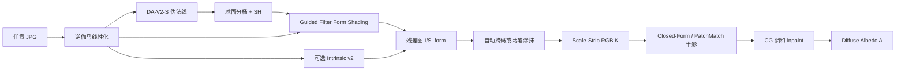

# 任意 JPG → Diffuse / Albedo Map：SOTA 调研与 Delighter 2D 迁移蓝图

> 调研日期：2026-11-26  
> 目标：把 Agisoft Texture De-Lighter 2.2.2 的「3D 辅助纹理去光照」思想，迁移到**任意单张 2D JPG**，得到接近摄影测量 Diffuse Map 的平坦固有色。  
> 范围：本机算力摸底 + 2024–2026 开源模型横评 + 无 Mesh 条件下的经典几何/优化管线改造。

---

## 0. TL;DR（给主 Agent 的结论）

1. **问题本质不是「再找一个去阴影网络」。** Delighter 能出干净 Diffuse Map，是因为它把光照拆成两件完全不同的事：  
   - **Form Shading（曲面体积光影）**：由 3D 法线角度分布 + 引导滤波去掉；  
   - **Cast Shadow（投射本影/半影）**：由边界 Scale-Strip 估计 RGB 光照比 + PatchMatch 半影抠图 + 调和修补去掉。  
   单图 IID 模型几乎只擅长前者；单图 Shadow Removal 模型几乎只擅长后者。任意 JPG 要「像 Delighter」，必须**双轨串联**，而不是二选一。

2. **本机不能当 NVIDIA 工作站用。** 实测为 2020 iMac（`iMac20,2`）：Intel Core i7 3.8 GHz 8 核 / 32 GB RAM / AMD Radeon Pro 5700 8 GB Metal。**不是 Apple Silicon，官方 PyTorch MPS 不可用，没有 CUDA，macOS 上也没有 ROCm。** 扩散模型（RGB↔X、Marigold-IID、StableDelight、StableShadowRemoval）在本机基本不可落地。磁盘只剩约 **25 GB**，大权重也装不下几套。

3. **本机最该走的路：路线 B 为主、路线 A 只借「轻量 CNN」当可选先验。**  
   - **立刻可做**：在 `photo2vector/.venv`（已有 numpy/scipy/opencv/skimage）上实现 Scale-Strip + 引导滤波 + 稀疏拉普拉斯，支持用户两笔涂抹亮/暗部。  
   - **第一周可加**：Depth-Anything-V2-Small（Apache-2.0，24.8M，有 CoreML/ONNX）生成伪法线，驱动 `angular_data` 式球面分桶光照拟合。  
   - **唯一值得在本机尝试的深度学习 albedo 模型**：`compphoto/Intrinsic` v2（CNN 而非扩散，约 1 GB 权重，1024 px / ~5 GB 峰值；**但学术许可 + 专利保护，商用必须找 SFU**）。  
   - **不要本机硬跑**：RGB↔X（≥12 GB NVIDIA + Adobe 非商用）、Marigold-IID（0.9B 扩散，768 px）、StableDelight（本质是去高光，不是去投射阴影）。

4. **旧笔记最大缺口**：把 De-Lighter 当成「通用 IID + 泊松」，没有切开 Form Shading vs Cast Shadow，也没有 Scale-Strip / Umbra–Penumbra / PatchMatch matting。那正是 JPG 转 Diffuse Map 失败的根因。

---

## 1. 问题重定义：为什么「单图去阴影」≠「得到 Diffuse Map」

摄影测量纹理上的观测亮度，在线性域更接近：

\[
I = A \odot S_{\text{form}} \odot S_{\text{cast}} + R_{\text{spec}}
\]

| 符号 | Delighter 对应模块 | 物理含义 | 在 2D JPG 上的典型失败 |
| --- | --- | --- | --- |
| \(A\) | 最终 albedo / diffuse texture | 固有色，应尽量分段常数、保留纹理 | 被阴影黑边或体积明暗污染 |
| \(S_{\text{form}}\) | `delighting/shading/angular_data.cpp` + Guided Filter | 曲面朗伯明暗、AO、低中频环境光 | 纯去阴影网络会把它当「物体本身」留下 |
| \(S_{\text{cast}}\) | `delighting/cast_shadows/`（本影 Umbra + 半影 Penumbra） | 他物遮挡造成的硬/软投射阴影，RGB 三通道比例常因色温不同 | IID 常把硬边留在 albedo，或把深色材质当阴影 |
| \(R_{\text{spec}}\) | shading 残差 / highlights | 高光、光源、过曝 | StableDelight 主要打这一项，不是 \(S_{\text{cast}}\) |

Agisoft 能做对，是因为有 **Mesh 法线 → UV 烘焙的几何先验**，再叠加用户亮/暗笔触作为泊松方程的 Dirichlet 锚点。任意 JPG **没有 Mesh、没有 UV、没有多视角**，必须用伪几何 + 2D 阴影物理模型把这两项约束补回来。

### 1.1 两条文献轨道的结构性错位（关键痛点）

```
                    ┌─ IID / Inverse Rendering ─┐
                    │ 擅长：柔和渐变、体积明暗、  │
                    │      色温、高光残差         │
  任意 JPG ──────►  │ 弱点：硬投射阴影边界黑边；  │
                    │      深色材质 ↔ 深阴影歧义  │
                    └────────────┬───────────────┘
                                 │ 单独用 → 得到「去了体积光但还有影子」
                                 ▼
                    ┌─ Shadow Removal ──────────┐
                    │ 擅长：本影检测、半影过渡、  │
                    │      阴影区域纹理恢复       │
                    │ 弱点：保留 3D 体积 shading；│
                    │      不输出平坦 Diffuse Map │
                    └────────────┬───────────────┘
                                 │ 单独用 → 得到「去了影子但物体仍是圆的」
                                 ▼
                    目标：A ≈ Diffuse Map（两者都要去掉）
```

这正是用户最终诉求里点名的双失败模式，也是旧笔记没有写透的部分。

### 1.2 旧笔记缺口对照

来源：`de_lighter/Agisoft De-Lighter 原理分析.md`、`de_lighter/图片去光照开源算法研究.md`（约 2025-11 基于许可证推断，尚未吃到二进制里的 `cast_shadows/` 与 `atlas_matting.cpp`）。

| 旧笔记已覆盖 | 对「任意 JPG → Diffuse」仍然缺失 |
| --- | --- |
| \(I=R\odot S\) 与对数域 IID | 没有把 \(S\) 拆成 \(S_{\text{form}}\times S_{\text{cast}}\) |
| Guided Filter + Poisson + CHOLMOD | 没有 Scale-Strip、Umbra/Penumbra、`dilatePenumbraFast` |
| 3D 几何先验（法线/AO）很重要 | 没有回答「没有 Mesh 时如何造伪几何」 |
| Retinex / MSR 快速原型 | 会在硬阴影边界制造光晕，且不去色温偏移 |
| `compphoto/Intrinsic`、Intrinsic Image Diffusion 被点名 | 停在 2023 灰度 shading；未评 2024 Colorful v2、RGB↔X、Marigold-IID Lighting、StableDelight 的**任务错位** |
| 假定有 NVIDIA / 高显存 | 没有对本机 Intel+AMD 做可行性裁剪 |
| 用户笔触 = 泊松锚点 | 没有把笔触接到「RGB 三通道阴影比」估计 |

并行逆向已经补上的真实模块，必须写进 2D 迁移，而不是继续停留在「引导滤波 + 泊松」这一层抽象：

1. `delighting/shading/angular_data.cpp`：法线球面分桶 → 定向光 + AO，再 Guided Filter 去 Form Shading / Highlights。  
2. `delighting/cast_shadows/`：`shadow_masks`、`dilatePenumbraFast`、`reduceShadowMatting`、`scale_strip`。  
3. `delighting/atlas_processing/`：PatchMatch 阴影 Alpha Matting + CHOLMOD/CG 光滑插值。

---

## 2. 本机环境与算力摸底

### 2.1 硬件（2026-11-26 实测）

| 项 | 实测值 | 对项目的含义 |
| --- | --- | --- |
| 机型 | `iMac20,2`（2020 款 27″ 5K iMac） | Intel 时代机器，不是 M 系列 |
| CPU | Intel Core i7 **3.8 GHz / 8 核**（Apple 该机型对应 10 代 i7-10700 配置） | 经典稀疏求解、引导滤波、Scale-Strip 完全够用 |
| 内存 | **32 GB** | 4K 图的拉普拉斯系统（约 8–16M 未知数）可用 CG；扩散模型权重+激活会挤爆 |
| GPU | **AMD Radeon Pro 5700，8 GB VRAM，Metal Supported** | 无 CUDA；官方 PyTorch MPS 要求 Apple Silicon（[Apple Metal PyTorch](https://developer.apple.com/metal/pytorch/) 写明 Mac + Apple silicon） |
| 系统 | macOS 15.7.7 Sequoia，`x86_64` | ROCm 不支持 macOS；AMD 卡在本机几乎只能走 **CoreML / ONNX Runtime CoreML EP（CPUAndGPU）** |
| 磁盘 | 系统数据卷约 **25 GB 可用 / 466 GB** | 一套 SD 权重 2–5 GB，多模型并行下载不现实 |

**算力结论（事实，不是推断）：**

- 路线 B（NumPy/SciPy/OpenCV 优化）= 本机主战场。  
- 轻量 CNN / ViT-S（Intrinsic v2、DA-V2-Small、OmniSR/PhaSR 量级）= CPU 可跑，慢但可行；ONNX+CoreML 可能吃到 AMD GPU。  
- 0.9B 级扩散（RGB↔X、Marigold、StableDelight、StableShadowRemoval）= **本机不作为默认推理后端**。需要时用云 GPU 或后续换 Apple Silicon / NVIDIA 箱。

Lightning 维护者在 2025-08 仍明确：Intel 上 MPS 往往比 CPU 更慢，AMD + MPS 不在支持矩阵内（[pytorch-lightning#17667](https://github.com/Lightning-AI/pytorch-lightning/issues/17667)）。

### 2.2 Python 环境

系统解释器：`/usr/bin/python3` → **Python 3.9.6**（Command Line Tools）。没有 conda、没有 Homebrew、没有 SuiteSparse/CHOLMOD 预装。

| 环境 | Python | 已装、与本任务相关 | 缺失 |
| --- | --- | --- | --- |
| 系统 python3 | 3.9.6 | numpy 2.0.2, Pillow 11.3.0 | scipy / opencv / skimage / torch / onnxruntime / sksparse |
| `/Users/chichenchichen/Desktop/cursor/.venv` | 3.9.6 | Pillow, PyMuPDF, yt-dlp 等（办公向） | **连 numpy 都没有**，不适合本项目 |
| `/Users/chichenchichen/Desktop/cursor/photo2vector/.venv` | 3.9.6 | **numpy 2.0.2, scipy 1.13.1, opencv-contrib-python-headless 5.1.0, scikit-image 0.24.0, networkx 3.2.1, ImageIO 2.37.2** | torch, onnxruntime, scikit-sparse, pymatting, sklearn |

**落地建议：**

1. 路线 B 原型直接复用 `photo2vector/.venv`（已有稀疏线性代数与图像栈）。  
2. 另建 `python3.10+` 专用 venv（若可安装更新 Python）：Intrinsic v2 / DA-V2 / 现代 torch 对 3.10+ 更友好。  
3. CHOLMOD：`brew install suite-sparse` 后 `pip install scikit-sparse`；短期可用 `scipy.sparse.linalg.cg` + `pymatting.ichol` 不完全 Cholesky 预条件，不必卡在 CHOLMOD。  
4. 磁盘先给 DA-V2-Small（~100 MB）和（可选）Intrinsic v2（~1 GB）留配额，不要先拉 Marigold/RGB↔X。

---

## 3. 路线 A：2024–2026 开源模型横评

统一评价维度：**是否输出彩色 Diffuse Albedo**、硬投射阴影 vs 曲面软阴影、纹理保真、许可证、本机可行性。

### 3.1 总表

| 模型 | 年份 / 出处 | 真正输出 | 硬投射阴影 | 曲面 Form Shading | 纹理保真 | 许可 | 显存 / 分辨率 | 本机 Intel+AMD |
| --- | --- | --- | --- | --- | --- | --- | --- | --- |
| **Intrinsic v2** `compphoto/Intrinsic` | TOG / SIGGRAPH Asia 2024 | **彩色 albedo + 彩色 diffuse shading + residual** | 中上：ordinal 网络能切硬边，但有色互反射会进 albedo | **强**（设计目标） | 高；v2.1 加残差连接保细节 | **学术 only + 专利 pending**（SFU TLO） | CNN，约 1 GB 权重；独立测试 RTX 3070：**1024 px ~4.8 GB，1600 px 掉到 81 s（主机内存溢出）** | CPU 可试；无 CUDA。**本机最值得装的 DL albedo** |
| **StableDelight** `Stable-X/StableDelight` | 2024，基于 StableNormal/YOSO | **去高光后的纹理**，不是完整 albedo | 弱（任务不是这个） | 弱 | 高（专门保纹理锐度） | 代码/权重社区按 **Apache-2.0** 使用（HF `yoso-delight-v0-4-base`） | SD 系，处理分辨率默认 **2048**，权重约 3.3 GB | 8 GB AMD + 无 CUDA：**不建议** |
| **RGB↔X** `zheng95z/rgbx` | SIGGRAPH 2024 | Albedo / Normal / Roughness / Metallic / Irradiance | 室内场景较强，生成式「抹平」 | 强 | 中：易抹掉磨损/缝线（论文自承 wooden floor wear） | **Adobe Research License，仅非商用研究** | **NVIDIA ≥12 GB**；0.9B | **本机不可跑** |
| **Marigold-IID Lighting v1.1** | 2025-05-15 发布 | Albedo + colorful diffuse shading + residual（\(I=A*S+R\)，线性域） | 中（HyperSim 先验） | 强 | 中；潜空间 ~**768 px** | 权重 **OpenRAIL++-M**；代码 Apache | ~0.9B，需 SD2 底座 | CPU 极慢；磁盘紧 |
| **Marigold-IID Appearance v1.1** | 同上 | Albedo + roughness + metallic（sRGB albedo） | 不针对阴影 | 部分 | 中 | 同上 | 同上 | 同上；更偏 PBR 材质而非去阴影 |
| **Lotus** `EnVision-Research/Lotus` | ICLR 2025 | **只出 Depth / Normal** | 无 albedo | 作为几何先验有用 | — | 开源推理代码（项目页 lotus3d.github.io） | 扩散单步，仍偏重 | **只当伪几何模块，不当 De-lighter** |
| **HomoFormer** | CVPR 2024 | 无阴影 RGB | **强（ISTD+/SRD）** | 几乎不去除 | 中 | GitHub 未标许可证 | 中等 CNN/Transformer | CPU 可试，但**得不到 Diffuse Map** |
| **ShadowDiffusion** | CVPR 2023 | 无阴影 RGB | 强 | 不去除 | 生成感 | 研究代码 | 扩散 | 本机不合适 |
| **OmniSR** | AAAI 2025 | 无阴影 RGB（室内直射+间接） | 强，RGB-D，无 mask | 不去除 | 中高 | **MIT** | 24.6M / 78G FLOPs | 轻，可 CPU；需深度 |
| **PhaSR** | CVPR 2026 | 无阴影 RGB + 环境光归一 | **当前 WSRD+ SOTA PSNR 28.44** | 部分（PAN Retinex 预处理） | 中高 | **MIT**；2026-07 修过 checkpoint | **18.95M / 55.6G**，比 OmniSR 更轻 | **最值得跟的 2D 去硬阴影 CNN** |
| **SoftShadow** | CVPR 2025 | 软 mask（本影/半影）+ 去阴影 | **半影边界 SOTA 思路** | 不去除 | 边界伪影少 | 论文已公开 | 依赖 SAM | 其「软 mask」思想应迁入路线 B |
| **StableShadowRemoval** | CVPR 2025 | 无阴影 RGB | 强，跨数据集 | 不去除 | 二阶段注入细节 | 有官方代码 | SD 微调 | 本机不合适 |

### 3.2 各模型要点（含任务错位警告）

#### 3.2.1 Colorful Diffuse IID（Careaga & Aksoy 2024）— 路线 A 首选 albedo

- 论文：[yaksoy.github.io/ColorfulShading](https://yaksoy.github.io/ColorfulShading/) · arXiv [2409.13690](https://arxiv.org/abs/2409.13690)  
- 代码：https://github.com/compphoto/Intrinsic · `load_models('v2')`；v2.1（2025-04）加强 albedo 细节。  
- 成像模型：\(I = A_d \odot S_d + R\)。分步去掉「灰度 shading」和「纯朗伯」假设：chroma 网 → 高分辨率稀疏 albedo → diffuse shading 网。  
- **对硬阴影：** 2023 ordinal shading 论文明确能保留 shading 硬边、albedo 稀疏；2024 补充色度，缓解「有色二次反射把阴影色写进 albedo」。仍可能在极深本影、黑材质处歧义。  
- **许可红线：** README 写明 academic use only，方法论有 IP 保护；专利 WO2025019958A1（SFU，2025-01 公开）。商用必须联系 `tlo_dir@sfu.ca` / Yağız Aksoy。独立项目 [jazwinn/ImageLighting](https://github.com/jazwinn/ImageLighting) 也因此默认不打包该依赖。  
- **本机：** 非扩散 CNN，是唯一「可能在 32 GB CPU 上出一张 1024 图」的高质量 albedo 网络。建议锁 1024 长边，shading 上采样后再 \(A = (I-R)/S\) 回到原分辨率（ImageLighting 验证过恒等误差 ~0）。

#### 3.2.2 StableDelight — 名字像 De-lighter，任务其实是去高光

- https://github.com/Stable-X/StableDelight · 权重 [Stable-X/yoso-delight-v0-4-base](https://huggingface.co/Stable-X/yoso-delight-v0-4-base)  
- 训练数据：Hypersim、Lumos、TSHRNet 高光数据集。多尺度 SSIM + 随机条件尺度，服务 **one-step 去镜面反射**。  
- 3D 工作流是：多视图渲染 → 逐张 delight → `texrecon` 贴回 mesh。这是 **specular-free texture**，不是去掉投射阴影后的 albedo。  
- 对用户目标「任意 JPG 去阴影得 Diffuse Map」：**只能当高光子模块**，绝不能当主模型。否则地面影子、脸侧 AO 都会留下。

#### 3.2.3 RGB↔X — 室内生成式 PBR 分解，质量高但幻觉+许可+硬件三座山

- 论文 SIGGRAPH 2024；代码 https://github.com/zheng95z/rgbx ；权重 `zheng95z/rgb-to-x`（0.9B）。  
- 官方：仅 NVIDIA，**最低 12 GB**。Prompt 切换通道：`"Albedo (diffuse basecolor)"` 等。  
- 论文承认：室内合成数据偏差（绿=植物）、会抹掉真实磨损；Hypersim 有时把 shading bake 进 albedo GT。  
- **Adobe Research License：禁止商业产品。** 与 Intrinsic v2 一样不能进商用管线。

#### 3.2.4 Marigold-IID 与 Lotus

- Marigold-IID Lighting 与 Intrinsic v2 **同一残差模型** \(I=A*S+R\)，但底座是 SD2 扩散，原生有效分辨率约 768。权重 OpenRAIL++-M（有使用限制条款）。  
- Appearance 变体走 InteriorVerse BRDF（albedo/rough/metal），更偏游戏 PBR，不是阴影物理。  
- **Lotus 不是 IID**：ICLR 2025 扩散几何基础模型，只做 depth/normal。它应出现在路线 B 的「伪法线」候选列表，与 DSINE、DA-V2 并列，而不是 albedo 模型。

#### 3.2.5 硬阴影 SOTA（2024–2026）— 只负责 \(S_{\text{cast}}\)，必须再接 Form Shading 去除

WSRD+ 榜（[sota2.com](https://www.sota2.com/research/sota/shadow-removal-on-wsrd-plus)，约 2026-04）：

| 名次 | 方法 | PSNR | 备注 |
| --- | --- | --- | --- |
| 1 | **PhaSR (CVPR 2026)** | 28.44 | MIT；PAN（灰世界+对数 Retinex）+ GSRA（DA-V2 几何 − DINOv2 语义） |
| 2 | CFSR (2026) | 27.37 | |
| 3 | DenseSR (ACMMM 2025) | 26.28 | |
| 4 | StableShadowRemoval (CVPR 2025) | 26.26 | SD 潜空间 + 细节注入 |
| … | OmniSR (AAAI 2025) | 26.07 | MIT；RGB-D，无 mask |
| 更早 | HomoFormer (CVPR 2024) / ShadowFormer / ShadowDiffusion | 更低 | 仍是常用基线 |

**PhaSR 与本项目的特殊亲和性：** 它已经在用 Depth-Anything-v2 几何注意力，和 Delighter「几何先验区分材质 vs 阴影」是同一哲学；参数量 19M，本机 CPU 可考虑。但它的输出仍是「无阴影照片」，体积光还在。正确用法是：**PhaSR/OmniSR 当 \(S_{\text{cast}}\) 预处理器，再把结果送进 Form Shading 去除。**

**SoftShadow (CVPR 2025)** 不追求榜首 PSNR，但提出 **软 mask 区分 Umbra/Penumbra**，直接对应 Delighter 的 `dilatePenumbraFast` + `reduceShadowMatting`。路线 B 应吸收其物理约束损失的思想（不必整网复现 SAM 微调）。

### 3.3 路线 A 在本机上的现实裁剪

```
可本机试用（按优先级）
  1. Intrinsic v2 @ ≤1024  CPU   [许可：研究原型 OK / 商用 NO]
  2. Depth-Anything-V2-Small ONNX+CoreML   [Apache-2.0]
  3. PhaSR / OmniSR 轻量 CNN 去硬阴影       [MIT]
  4. DSINE 法线（学术非商用，Imperial College）

明确不要本机作为默认
  RGB↔X、Marigold-IID、StableDelight、StableShadowRemoval、Lotus-G 全图扩散
```

---

## 4. 路线 B：把 Delighter 核心数学迁到纯 2D Python

无 Mesh 时，Delighter 缺三样输入：**法线图、UV 图集、用户可选的亮/暗笔触**。下面按模块给出 2D 替代，全部可在 scipy/opencv 实现，不依赖生成模型，无幻觉，分辨率只受内存限制。

### 4.1 总公式与线性域铁律

输入 JPG 必须先逆伽马（近似）：

\[
I_{\text{lin}} = I_{\text{sRGB}}^{2.2}
\]

目标：

\[
A = \frac{I_{\text{lin}} - R_{\text{spec}}}{S_{\text{form}} \odot S_{\text{cast}} + \varepsilon}
\]

所有乘除、RGB 比、泊松都在线性域；写回 JPG 再 \(\gamma=1/2.2\)。旧笔记这条仍然正确，必须坚持。

### 4.2 模块 1 — 伪几何先验（替代 Mesh 法线）

| 候选 | 许可 | 本机 | 用途 |
| --- | --- | --- | --- |
| **Depth-Anything-V2-Small** | **Apache-2.0**（Base/Large 是 CC-BY-NC） | 24.8M；有 [Apple CoreML](https://huggingface.co/apple/coreml-depth-anything-v2-small) 与 ONNX | **首选**。深度 → 伪法线 |
| DSINE (CVPR 2024 Oral) | Imperial **非商用** | 任意分辨率、法线更「分片光滑」 | 研究原型可用，产品需授权 |
| Lotus-Normal v1.1 | 开源推理 | 扩散，偏重 | 质量参考，不作默认 |
| 无网络 fallback | — | 多尺度色度 + 结构张量 | 只能提供弱边缘，不能驱动 angular_data |

**深度 → 法线（针孔近似，焦距未知时用 \(f \approx 1.2\cdot\max(H,W)\)）：**

\[
\mathbf{n}(x,y) \propto \left(
\frac{\partial Z}{\partial x},\;
\frac{\partial Z}{\partial y},\;
-1
\right)
\quad\text{或相机坐标叉积}\quad
\partial_x \mathbf{P} \times \partial_y \mathbf{P}
\]

对法线做一次双边/引导滤波，避免 DA-V2 的高频噪声进入光照拟合。可选 SSAO：在伪点云上做半球采样，得到 \(AO_{\text{proxy}}\)，对应 Delighter 的环境光遮蔽通道。

### 4.3 模块 2 — `angular_data` 的 2D 版：球面分桶 + 低阶 SH

Delighter 用 3D 法线的角度直方图估计定向光。2D 伪法线同样能做 **法线索引的球面统计**（与 SPLiT、GLoSH 同一几何想法，但这里是经典稳健估计，不是再训练一个网）：

1. 把 \(\mathbf{n}\) 量化到球面（细分二十面体 ~162 桶，或 \(L=8\) 经纬网格）。  
2. 每桶收集像素的 \(\log I_{\text{lin}}\)（可先做色度归一 \(I/(\sum I+\varepsilon)\) 以免纹理污染）。  
3. 每桶取 **中位数**（抗纹理、抗小块阴影）。  
4. 用桶中心法线拟合：  
   - 最简：一束定向光 + RGB 环境光  
     \(S_{\text{geo}} = c_{\text{amb}} + c_{\text{dir}}\odot\max(\mathbf{n}\cdot\mathbf{l},0)\)  
   - 更稳：二阶球谐（9 系数灰度或 27 系数 RGB），对应 GLoSH 的 global SH。  
5. 得到 \(S_{\text{geo}}\) 后，**以 \(S_{\text{geo}}\)（或伪法线）为引导图**，对 \(\log I\) 做 Guided Filter（He et al. 2010/2015；OpenCV `ximgproc.guidedFilter` 已在 opencv-contrib 中）。  

输出 \(S_{\text{form}}\)：继承几何结构、不含纹理。  
残差 \(I / S_{\text{form}}\) 仍含 **Cast Shadow**——这是设计如此，交给下一模块。

**高光：** 在线性域，\(I_{\text{lin}} - A_{\text{tmp}}\odot S_{\text{form}}\) 的正残差即为 \(R_{\text{spec}}\) 初值；可用百分位钳位，不必上 StableDelight。

### 4.4 模块 3 — Cast Shadow：Scale-Strip 原汁原味迁移

二进制里的 `scale_strip.cpp` 几乎可以肯定对应计算机视觉里已经写清楚的 **Penumbra Strip** 方法，而不是什么未发表黑盒：

- Gong & Cosker, **Interactive Shadow Removal and Ground Truth…**, BMVC 2014  
- Gong, Yang, Cosker, **User-Assisted Image Shadow Removal**, Image and Vision Computing  

这两篇就是「沿阴影边界垂直采样 → 展开成条带 → 估计每通道光照比 → inpaint 成稠密 scale field → 反除」。与 Delighter 用户两笔涂抹亮/暗部的 UX 完全同构。

**算法步骤（建议直接写成 Python 参考实现）：**

1. **阴影掩码**  
   - 自动：\(I/S_{\text{form}}\) 上的低亮度 + 与邻近同色度像素的对数比；或 PhaSR 注意力图；或 SAM 粗分割。  
   - 交互（应对齐 Delighter）：用户涂 **Lit** 与 **Umbra** 两笔 → 区域增长 / GrabCut 得到硬掩码 \(M\)。  
2. **半影带宽**（`dilatePenumbraFast`）  
   - 对 \(M\) 做距离变换；带宽 \(\tau\) 由边界法向梯度宽度自适应（SoftShadow 的 soft mask 可替换固定膨胀）。  
   - Umbra：\(M\) 腐蚀；Penumbra：环带；Lit：其余。  
3. **垂直采样**  
   - 提取 \(M\) 的有向边界；每隔 \(s\) 像素沿法线采一条 profile，长度覆盖半影两侧各 \(w\) 像素。  
4. **条带对齐与剔野**  
   - 每条 profile 计算对数域 RGB 差 \(\mathbf{Y}_c = \bar{T}_{\text{lit}} - \bar{T}_{\text{shd}}\)，转球坐标后 DBSCAN（Gong 2014：半径 0.2）。只留最大簇。  
   - 将变长 profile resize 到统一长度，拼成 strip。  
5. **逐通道拟合阴影比**  
   - 对 strip 列取均值得 \(G(x)\)；分段三次 Hermite 或 logistic：  
     \[
     S_{\text{ch}}(x)=\begin{cases}
     K_{\text{ch}} & x < x_1 \quad\text{(umbra)}\\
     \text{monotone}(x;x_1,x_2,K_{\text{ch}},1) & x_1\le x\le x_2\\
     1 & x > x_2 \quad\text{(lit)}
     \end{cases}
     \]  
   - **\(K_R,K_G,K_B\) 独立** → 色温一致的本影恢复（冷阴影下蓝通道 \(K\) 更小）。这是灰阶 Retinex 做不到的。  
6. **稠密 scale field**（`atlas_inpainting` / 调和修补）  
   - 把稀疏 \(K\) 与半影曲线撒回图像；在未知区解  
     \[
     \Delta \mathbf{s} = 0 \quad\text{或}\quad \Delta \mathbf{s} = \operatorname{div}(\mathbf{v})
     \]  
     Dirichlet：Lit 处 \(\mathbf{s}=\mathbf{1}\)，Umbra 种子处 \(\mathbf{s}=\mathbf{K}\)，半影处为采样值。  
   - 离散五点拉普拉斯 → `scipy.sparse.linalg.cg`（`rtol=1e-6`）或 `spsolve`；预条件用 `pymatting.ichol`。4K 图优先 CG，不要一上来直接分解 16M×16M。  
7. **反除**  
   \[
   I_{\text{unshadowed}} = I_{\text{lin}} \oslash S_{\text{cast}}
   \]  
   再除 \(S_{\text{form}}\) 得 \(A\)。

### 4.5 模块 4 — PatchMatch / Closed-Form 半影抠图（`atlas_matting`）

半影不是二元 mask。Delighter 的 `reduceShadowMatting` + PatchMatch 采样，对应：

- **Trimap**：Umbra=1，Lit=0，Penumbra=unknown。  
- **Closed-Form Matting**（Levin et al. 2007）→ `pymatting.estimate_alpha_cf`（MIT，纯 CPU，SciPy+Numba）。输出 \(\alpha\in[0,1]\) 当作「被遮挡的光照比例」。  
- **PatchMatch**（Barnes et al.）：在 Lit 区为每个半影/本影像素找同纹理邻域，估计局部 RGB 比，抑制「把深色纹样当阴影」。可用 `scikit-image` 的 patch 匹配或简化随机搜索；不必引入 CUDA PatchMatch。  
- 最终  
  \[
  S_{\text{cast}} = (1-\alpha)\cdot\mathbf{1} + \alpha\cdot\mathbf{K}(x)
  \]  
  其中 \(\mathbf{K}(x)\) 来自 Scale-Strip 的空间插值。

这一步专门消灭「黑边 / 光晕」——IID 最常见的失败模式。

### 4.6 模块 5 — 用户两笔如何变成线性系统约束

与 Agisoft GUI 对齐的最小交互：

| 用户动作 | 写入方程的方式 |
| --- | --- |
| 亮部笔触 | \(s(p)=\mathbf{1}\)（该像素 RGB 光照比为 1） |
| 暗部笔触 | 在笔触邻域与最近亮部笔触之间估计 \(\mathbf{K}\)，作为 Umbra Dirichlet |
| 无笔触 | 全自动：\(S_{\text{form}}\) 残差 + 色度一致性 |

硬约束用「把对应行替换成单位行」而不是大 \(\lambda\) 惩罚，数值更稳（与 CHOLMOD 直接法习惯一致）。

### 4.7 模块对应表（二进制 → Python）

| Delighter | 2D Python | 库 |
| --- | --- | --- |
| Mesh 法线 / AO | DA-V2-Small → 差分法线 + 可选 SSAO | onnxruntime-coreml 或 torch CPU |
| `angular_data.cpp` | 球面分桶中位数 + SH / 定向+环境拟合 | numpy |
| Guided Filter 去 form shading | `cv2.ximgproc.guidedFilter` | opencv-contrib（本机 5.1 已装） |
| `shadow_masks.cpp` | 残差阈值 + 可选用户笔触 / GrabCut | opencv |
| `dilatePenumbraFast` | 距离变换环形带宽 | scipy.ndimage / cv2.distanceTransform |
| `scale_strip.cpp` | Gong 2014 penumbra unwrap + 分通道 Hermite | numpy |
| `reduceShadowMatting` / `atlas_matting.cpp` | Closed-Form + 可选 PatchMatch | pymatting |
| `atlas_inpainting.cpp` CHOLMOD/CG | 拉普拉斯 / 泊松 | scipy.sparse.linalg.cg；可选 sksparse.cholmod |
| Highlights | 正残差钳位 | numpy |

### 4.8 伪代码级数据流

```
JPG
 └─ linearize (γ=2.2)
     ├─ [opt] Intrinsic v2 @1024 → A0, Sd, R          # 路线 A 热启动
     ├─ DA-V2-S → Z → n̂, AO_proxy
     ├─ angular bins(n̂) → S_geo
     ├─ guided_filter(log I, guide=S_geo) → S_form
     ├─ I1 = (I - R_spec) / S_form                    # 仍含 cast shadow
     ├─ mask / strokes → umbra, penumbra, lit
     ├─ scale_strip(I1, boundary) → K_rgb, sparse s
     ├─ alpha_matting(trimap) → α
     ├─ poisson_inpaint(sparse s) → S_cast            # RGB
     └─ A = I1 / S_cast
         └─ gamma encode, optional albedo median-filter in n̂ bins
```

---

## 5. 面向本机的分阶段架构蓝图

原则：**先可运行、可交互、无幻觉的路线 B；再按许可与算力把路线 A 插进缝里。**

### Phase 0 — 本周：纯 2D 混合优化 MVP（不装深度学习）

- 环境：`photo2vector/.venv` + `pip install pymatting`。  
- 功能：用户涂亮/暗 → Scale-Strip 三通道 \(K\) → CG 调和场 → 反除。可选 Guided Filter 自引导去一层柔和 shading。  
- 成功标准：硬阴影边界无黑边、RGB 色温回正、纹理不 smear。  
- 已知不足：曲面体积光还在——这是 Phase 1 的事，不要在 MVP 用大高斯去「抹圆」。

### Phase 1 — 伪几何 Form Shading

- 接入 DA-V2-Small（优先 CoreML/ONNX，避免整份 torch）。  
- 实现 angular 分桶 + Guided Filter。  
- 成功标准：球体/圆柱/人脸侧光被拍平，棋盘/木纹还在；投射阴影仍留给 Phase 0 模块。

### Phase 2 — 可选 CNN 热启动（研究许可范围内）

- Intrinsic v2 出 \(A_0,S_d,R\)，**只作初始化**，再用 Scale-Strip 清掉网络残留硬边。  
- 或 PhaSR 先去硬阴影，再跑 Phase 1 去体积光（顺序与「先 form 后 cast」相反，需 A/B）。经验上 **先 form 后 cast 更稳**：先去掉几何相关的平滑项，硬阴影在残差里更「像阴影」。

### Phase 3 — 产品化（若目标含商用）

- **去掉** Intrinsic v2 与 RGB↔X（专利 / Adobe 非商用）。  
- 保留：DA-V2-Small（Apache）、PhaSR/OmniSR（MIT）、自研 Scale-Strip + 泊松。  
- DSINE 若商用需 Imperial 授权，用 DA-V2 法线即可。  
- 交互 UX 对齐 Delighter：两笔 + 可选「重新估计光照方向」。

### 推荐默认推理图（研究原型）



### 分辨率与性能预算（32 GB / 8 核粗估）

| 步骤 | 2K 图 | 4K 图 |
| --- | --- | --- |
| Guided Filter | <1 s | 1–3 s |
| Scale-Strip + 聚类 | 1–2 s | 3–6 s |
| Closed-Form matting（半影带宽内） | 数秒 | 需把未知区限制在环带，勿对整图建拉普拉斯 |
| CG 泊松 3 通道 | 数秒–十几秒 | 可能 30–60 s；分块或多重网格 |
| DA-V2-S CPU | 数秒 | 先缩到 518 再上采样法线 |
| Intrinsic v2 CPU | 分钟级 @1024 | **禁止原分辨率** |

---

## 6. 风险、许可证与信息缺口

### 6.1 许可证（商用决策用）

| 资产 | 许可 | 研究原型 | 商用产品 |
| --- | --- | --- | --- |
| Intrinsic v2 权重/代码 | 学术 + 专利 pending | 可以 | **不可以**（需 SFU 授权） |
| RGB↔X | Adobe Research License | 可以 | **不可以** |
| Marigold 权重 | OpenRAIL++-M | 可以（遵守使用限制） | 需读条款，不是标准 Apache |
| StableDelight | 按 Apache-2.0 分发使用 | 可以 | 相对干净，但**解决不了主任务** |
| DA-V2-Small | Apache-2.0 | 可以 | **可以** |
| DA-V2-Base/Large | CC-BY-NC | 可以 | 不可以 |
| PhaSR / OmniSR | MIT | 可以 | **可以** |
| DSINE | Imperial 非商用 | 可以 | 需合同 |
| pymatting | MIT | 可以 | 可以 |
| Gong/Cosker 算法 | 论文方法，自己实现 | 可以 | 可以（实现自有代码） |

### 6.2 仍不确定、需要后续核实的点

1. Delighter `scale_strip.cpp` 与 Gong 2014 的逐行对应关系：目前是**高置信推断**（模块名、本影/半影、RGB 比、调和修补全部吻合），最终应以并行逆向 Agent 的反编译伪代码为准。  
2. `angular_data` 是 SH、von Mises–Fisher 混合，还是离散光源+AO：2D 版用「分桶中位数 + 定向+环境」足够；若逆向给出精确球谐阶数再对齐。  
3. PyTorch 在该 Intel Mac 上 `torch.backends.mps.is_available()` 的真实返回值未测（当前无 torch）。即使返回 True，也不应作为产品路径。  
4. ONNX Runtime CoreML EP 在 **Intel + AMD 5700** 上能否稳定加速 DA-V2：文档支持 macOS 10.15+ 的 `CPUAndGPU`，但最佳路径是 ANE，本机没有 ANE。需要 Phase 1 做一次 20 张图的实测。  
5. PhaSR 2026-07 checkpoint 是否已完全修好：README 称已修复，接入前应在 ISTD+ 抽几张回归。  
6. 用户 JPG 的场景分布未知（静物/人像/建筑/游戏贴图）。若以「扫描物体贴图」为主，Intrinsic v2 与 RGB↔X 的室内先验会偏；路线 B 更稳。

### 6.3 明确不建议的弯路

- 只用 MSR/Retinex 交差：硬边光晕 + 灰阶，色温错。  
- 只用 HomoFormer/PhaSR 交差：影子没了，球体还是圆的。  
- 只用 Intrinsic/Marigold 交差：体积光很好，深影子黑边和黑材质混淆仍在。  
- 本机上电 Stable Diffusion 系模型：8 GB AMD 不可用，32 GB CPU 跑 0.9B 潜空间不划算，磁盘也不够。

---

## 7. 给主 Agent 的下一步（可直接派工）

1. **实现 Phase 0**（`delight/` 或独立包）：`linearize` → 笔触 mask → `scale_strip` → `cg_inpaint` → 反除；用 2–3 张含硬阴影+纹理的 JPG 做回归（棋盘上的影子、人脸侧影、包装盒）。  
2. **并行**：安装 DA-V2-Small CoreML/ONNX，写 `depth_to_normal` + `angular_bins` + `guided_filter` 单元测试。  
3. **不要**先搭 RGB↔X/Marigold 环境。  
4. 等逆向 Agent 给出 `scale_strip.cpp` / `angular_data.cpp` 伪代码后，把 Phase 0/1 的公式系数（分桶数、Hermite 单调性、半影带宽）改成与 Delighter 一致。  
5. 若研究演示需要「开箱最好看」：在学术许可下加 Intrinsic v2 开关，UI 标明非商用。

---

## 参考来源

### 本地

- `de_lighter/Agisoft De-Lighter 原理分析.md`  
- `de_lighter/图片去光照开源算法研究.md`  
- 本机 `system_profiler` / venv `pip list`（2026-11-26）

### 论文与项目（2023–2026）

- Careaga & Aksoy, *Intrinsic Image Decomposition via Ordinal Shading*, TOG 2023. https://arxiv.org/abs/2311.12792  
- Careaga & Aksoy, *Colorful Diffuse Intrinsic Image Decomposition in the Wild*, TOG 2024. https://yaksoy.github.io/ColorfulShading/ · https://github.com/compphoto/Intrinsic  
- Zeng et al., *RGB↔X*, SIGGRAPH 2024. https://zheng95z.github.io/publications/rgbx24.html · https://github.com/zheng95z/rgbx  
- Ke et al., *Marigold* 扩展 IID v1.1，2025-05. https://github.com/prs-eth/Marigold · HF `prs-eth/marigold-iid-lighting-v1-1`  
- He et al., *Lotus*, ICLR 2025. https://lotus3d.github.io/ · https://github.com/EnVision-Research/Lotus  
- Stable-X, *StableDelight*, 2024. https://github.com/Stable-X/StableDelight  
- Xiao et al., *HomoFormer*, CVPR 2024. https://github.com/jiexiaou/HomoFormer  
- Guo et al., *ShadowDiffusion*, CVPR 2023. https://github.com/GuoLanqing/ShadowDiffusion  
- Xu et al., *OmniSR*, AAAI 2025. https://github.com/BlackJoke76/OmniSR  
- Lee et al., *PhaSR*, CVPR 2026. https://github.com/ming053l/PhaSR  
- Wang et al., *SoftShadow*, CVPR 2025. https://openaccess.thecvf.com/content/CVPR2025/html/Wang_SoftShadow_Leveraging_Soft_Masks_for_Penumbra-Aware_Shadow_Removal_CVPR_2025_paper.html  
- Xu et al., *StableShadowRemoval*, CVPR 2025. https://github.com/Hiahia1369/StableShadowRemoval  
- Gong & Cosker, BMVC 2014 penumbra strip；Gong et al., IVC user-assisted shadow removal  
- Bae & Davison, *DSINE*, CVPR 2024. https://github.com/baegwangbin/DSINE  
- Depth Anything V2, NeurIPS 2024. https://github.com/DepthAnything/Depth-Anything-V2  
- Levin et al., Closed-Form Matting, 2007；PyMatting https://github.com/pymatting/pymatting  
- He et al., Guided Filter, 2010/2015  
- Zhou et al., *GLoSH*, ICCV 2019（法线+SH 联合 IID）  
- WO2025019958A1, SFU, Intrinsic decomposition patent. https://patents.google.com/patent/WO2025019958A1  

### 工程实测与文档

- Apple, *Accelerated PyTorch training on Mac*（要求 Apple silicon）：https://developer.apple.com/metal/pytorch/  
- ONNX Runtime CoreML EP：https://onnxruntime.ai/docs/execution-providers/CoreML-ExecutionProvider.html  
- jazwinn/ImageLighting 对 Intrinsic v2 的 1024 px / 显存悬崖测量：https://github.com/jazwinn/ImageLighting  
